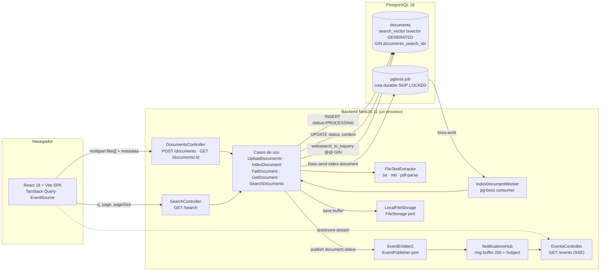
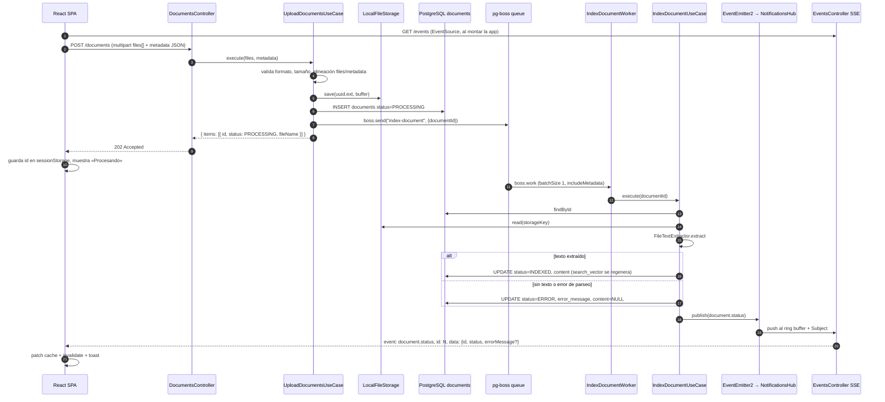
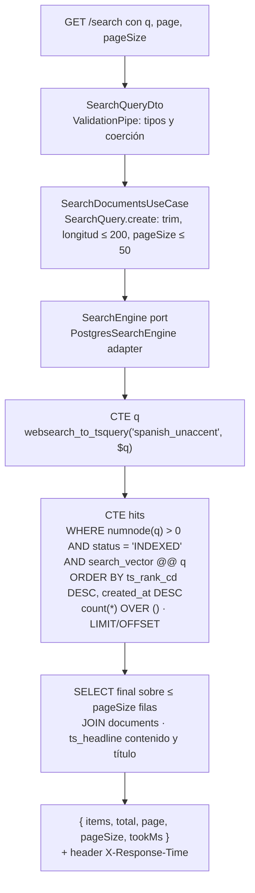
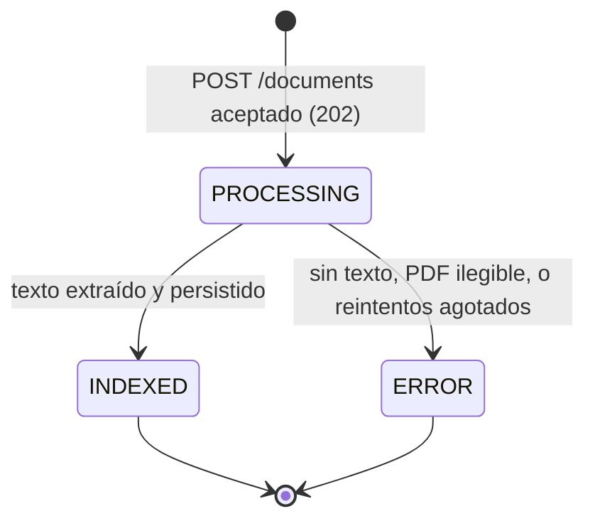

# Arquitectura — Buscador y Visor de Documentos Técnicos

Este documento responde a los cuatro puntos obligatorios del kata (diagrama, justificación de
decisiones, estrategia de tiempo real y escalabilidad) y añade las secciones necesarias para
defender el diseño en la sustentación: estructura del repositorio, flujo de estados, manejo de
errores, pruebas y límites conocidos. Cada afirmación sobre el código cita el archivo donde
puede verificarse.

## 1. Diagrama de arquitectura

### 1.1 Componentes y flujo



Motor de búsqueda y mecanismo de tiempo real no son servicios separados: el motor es el
subsistema FTS de PostgreSQL (`backend/src/search/infrastructure/persistence/postgres-search.engine.ts`)
y el tiempo real es un endpoint SSE del mismo proceso NestJS
(`backend/src/notifications/infrastructure/http/events.controller.ts`). Es una decisión
deliberada (sección 2) y la sección 4 describe cómo separar ambos cuando el volumen lo exija.

### 1.2 Secuencia: carga → job → indexación → SSE → UI



### 1.3 Ruta de una búsqueda



Archivos: `backend/src/search/infrastructure/http/search.controller.ts`,
`backend/src/search/domain/search-query.ts`,
`backend/src/search/application/search-documents.use-case.ts`,
`backend/src/search/infrastructure/persistence/postgres-search.engine.ts`.

## 2. Justificación de decisiones

Todas las decisiones se tomaron comparando alternativas frente a los requisitos del kata:
búsqueda indexada sin `LIKE`, respuesta entre 400 ms y 1 s, notificación en tiempo real sin
polling, entrega en menos de 24 h y una sustentación de 30 minutos. Ninguna se argumenta por
familiaridad con la herramienta.

### 2.1 Interpretación del requisito "entre 400 ms y 1000 ms"

Se interpreta como un SLO de latencia: **p95 ≤ 1 s** medido en el backend, expuesto en el header
`X-Response-Time` y en el campo `tookMs` de la respuesta
(`backend/src/search/infrastructure/http/search.controller.ts`,
`backend/src/search/application/search-documents.use-case.ts`). No se introduce ningún retraso
artificial para "alcanzar" los 400 ms: un sistema que responde en 20 ms cumple el objetivo con
margen, y penalizarlo deliberadamente sería contrario al propósito del requisito. La UI muestra
el `tookMs` como texto discreto junto al total
(`frontend/src/features/search/components/SearchLatency.tsx`) para que el cumplimiento sea
visible en la demo.

### 2.2 Base de datos y motor de búsqueda: PostgreSQL 16 FTS

| Opción | Ventajas | Desventajas | Veredicto |
|---|---|---|---|
| **PostgreSQL 16 FTS** (elegida) | Una sola infraestructura; índice y documento en la misma transacción (sin doble escritura); `tsvector` como columna generada, el índice se mantiene solo; GIN responde en milisegundos a este volumen; `websearch_to_tsquery` acepta frases y exclusiones sin romperse con entrada inválida | Sin tolerancia a errores tipográficos; ranking `ts_rank_cd` menos rico que BM25; `ts_headline` relee el texto; una sola configuración de idioma por columna | Cumple todos los requisitos con el menor riesgo operativo en el plazo |
| Elasticsearch / OpenSearch | BM25, fuzziness, agregaciones, sharding horizontal nativo | Segundo sistema con su propio ciclo de vida; doble escritura o CDC para mantener consistencia; JVM con mínimo de memoria alto para un demo; más superficie para fallar en `docker compose up` | Innecesario a esta escala; ruta de migración documentada en 4.4 |
| Meilisearch / Typesense | Ligero, typo-tolerance, buena DX | Mismo problema de consistencia (doble escritura); ranking menos configurable para pesos por campo; otro contenedor | Descartado por la misma razón de consistencia |
| SQLite FTS5 | Cero infraestructura | Sin concurrencia de escritura real, sin cola durable, inviable para varias réplicas | Descartado |

Implementación (`backend/drizzle/0000_init.sql`, `backend/src/shared/database/schema.ts`):

- Columna `search_vector tsvector GENERATED ALWAYS AS (...) STORED` con pesos `A` título,
  `B` autor + categoría + etiquetas, `C` contenido. PostgreSQL recalcula el vector en cada
  `INSERT`/`UPDATE`: no existe código de aplicación que pueda olvidarse de indexar.
- Índice `documents_search_idx` GIN sobre `search_vector`.
- Configuración de texto propia `spanish_unaccent` (`COPY = spanish`, mapeo
  `word/hword/hword_part → unaccent, spanish_stem`). Es necesaria porque `unaccent()` no es
  `IMMUTABLE` y una columna generada exige expresiones inmutables; en cambio, una
  configuración de búsqueda sí puede usarse dentro de `to_tsvector` en una columna generada.
  Límite conocido: los términos en inglés se indexan como tokens sin stemming.
- `array_to_string` es `STABLE`, no `IMMUTABLE`; se envuelve en `immutable_array_to_string`
  (SQL, `IMMUTABLE PARALLEL SAFE STRICT`) porque para `text[]` el resultado es determinista.
- Consulta (`postgres-search.engine.ts`): `websearch_to_tsquery` (frases entre comillas,
  `-exclusión`, `OR`), `@@` sobre el GIN, `ts_rank_cd` para ordenar, `count(*) OVER ()` para el
  total, y `ts_headline` **solo sobre la página** (a lo sumo `pageSize` filas, máximo 50) gracias
  a la CTE `hits` que devuelve ids. Cuando la consulta contiene solo stopwords (`numnode = 0`)
  el filtro corta antes de consultar el índice.

**Cumplimiento de "prohibido LIKE"**: la búsqueda usa exclusivamente el operador `@@` sobre el
índice GIN (`postgres-search.engine.ts` líneas 78 y 121). Se verificó con una búsqueda de
`\b(i?like)\b` sobre `backend/src`, `backend/test`, `backend/scripts` y `backend/drizzle`: no
existe ningún `LIKE` ni `ILIKE` en SQL; las únicas dos coincidencias son la palabra inglesa
"like" dentro de comentarios.

**Mediciones** (seed de 300 documentos sintéticos, `backend/scripts/seed.ts`):

| Medición | Resultado |
|---|---|
| Suite de integración, 20 consultas variadas sobre 340+ filas (`backend/test/search.integration-spec.ts`, Testcontainers) | p50 18.6 ms · p95 24.6 ms · max 34.6 ms |
| `pnpm --filter backend bench:search`, 200 peticiones, concurrencia 10, contra el stack de `docker compose` (`backend/scripts/bench-search.ts`) | servidor p50 18.7 ms · p95 49.9 ms · p99 58.5 ms · max 61.7 ms · ~330 req/s · 0 errores |
| `EXPLAIN (ANALYZE)` para `kubernetes pod` en el Postgres del stack (304 documentos indexados) | `Bitmap Index Scan on documents_search_idx` → `Bitmap Heap Scan` → `WindowAgg` → `Sort (top-N heapsort)`, 38 coincidencias, ejecución 5.0 ms |
| Consulta solo con stopwords (`de la en`) | `One-Time Filter: false`: la CTE `hits` ni siquiera toca la tabla |

Nota honesta sobre el planificador: con 300 filas y un término frecuente, PostgreSQL elige un
`Seq Scan` porque la tabla cabe en pocas páginas y es más barato que consultar el índice. La
prueba `uses the GIN index documents_search_idx for the hits query` lo contempla: si el plan
natural no usa el índice, repite el `EXPLAIN` con `SET LOCAL enable_seqscan = off` para
demostrar que el índice **es utilizable** para ese predicado (clase de operador y configuración
de texto coinciden), que es lo que importa cuando la tabla crezca. El `EXPLAIN ANALYZE` de
`kubernetes pod` (términos menos frecuentes) sí muestra el `Bitmap Index Scan` sin forzar nada.

### 2.3 Backend: NestJS 11

| Opción | Ventajas | Desventajas |
|---|---|---|
| **NestJS** (elegida) | Inyección de dependencias nativa: los puertos se registran con tokens `Symbol` y los casos de uso se arman con factories sin decoradores (`documents.module.ts`, `search.module.ts`); `ValidationPipe` + class-validator para DTOs; `ExceptionFilter` global como middleware de excepciones; `@Sse()` incorporado; `@nestjs/config` con validación de `.env`; mismo lenguaje que el frontend, lo que habilita `packages/shared` | Más capas que Express para un CRUD; curva de aprendizaje de módulos/providers |
| Express.js | Mínimo, sin opinión | DI, validación, filtros y SSE serían código propio: más superficie a revisar en 24 h |
| FastAPI | Excelente validación con Pydantic, async nativo | Segundo lenguaje en el monorepo; el contrato compartido con el frontend pasaría a OpenAPI generado |
| Spring Boot / Quarkus | Ecosistema maduro, DI potente | Tiempo de arranque y peso de contenedor mayores para la demo; dos lenguajes |

Decisión relacionada: se fijó **NestJS 11 + TypeScript 5.9** en lugar de NestJS 12 porque la
versión 12 es ESM-only y empuja a Vitest; mantener Jest + ts-jest (decisión 8 del plan) era
prioritario para reducir riesgo. Los tests corren con `--experimental-vm-modules` porque
pdf-parse (pdf.js) requiere `import()` dinámico (`backend/package.json`).

### 2.4 Tiempo real: SSE

| Opción | Ventajas | Desventajas |
|---|---|---|
| **SSE** (elegida) | Flujo unidireccional servidor → cliente, que es exactamente el caso (el cliente nunca envía por el canal); HTTP/1.1 plano, atraviesa proxies y CORS como cualquier GET; reconexión automática y `Last-Event-ID` implementados por el navegador en `EventSource`; `@Sse()` en Nest devuelve un `Observable` | Un stream por pestaña (límite de 6 conexiones por host en HTTP/1.1; irrelevante con HTTP/2); solo texto |
| WebSocket | Bidireccional, binario | Protocolo distinto (upgrade), reconexión y reenvío de eventos perdidos a cargo del cliente; requiere `@nestjs/websockets` + adaptador; bidireccionalidad que no se usa |
| GraphQL subscriptions | Integrado si la API fuera GraphQL | La API es REST; añadir GraphQL solo para suscripciones duplica la capa de transporte |
| Polling | Trivial | Prohibido por HU-04; latencia = intervalo; carga proporcional a pestañas abiertas |

La estrategia completa se describe en la sección 3.

### 2.5 Procesamiento asíncrono: pg-boss

| Opción | Ventajas | Desventajas |
|---|---|---|
| **pg-boss** (elegida) | Cola durable en la misma base (`SELECT ... FOR UPDATE SKIP LOCKED`), esquema propio `pgboss`; reintentos con backoff exponencial y expiración configurables (`index-document.job.ts`: `retryLimit 3`, `retryDelay 5`, `expireInSeconds 300`); sobrevive reinicios; el worker puede ejecutarse en otro proceso sin cambiar código | Throughput menor que Redis para millones de jobs; añade carga a Postgres |
| BullMQ + Redis | Muy alto throughput, UI de monitoreo | Segunda infraestructura (Redis) que debe levantar el evaluador; doble punto de fallo |
| In-process (`setImmediate`, cola en memoria) | Cero dependencias | Se pierde con cualquier reinicio; sin reintentos; no escala a varias instancias |

`UploadDocumentsUseCase` responde 202 en cuanto el archivo está en disco, la fila en
`PROCESSING` y el job encolado; la extracción de texto nunca ocurre en la petición HTTP
(`backend/src/documents/application/upload-documents.use-case.ts`).

### 2.6 Frontend: React 18 + Vite SPA

| Opción | Ventajas | Desventajas |
|---|---|---|
| **React + Vite** (elegida) | Herramienta interna sin requisitos de SEO ni SSR: una SPA es la arquitectura honesta; Vite arranca en milisegundos y su proxy `/api` resuelve CORS en desarrollo (`frontend/vite.config.ts`); TanStack Query gestiona caché, invalidación y `keepPreviousData` para la paginación; `EventSource` es nativo | Sin render en servidor (no se necesita) |
| Next.js | SSR/SSG, rutas de API | Servidor Node adicional en producción, complejidad de App Router, y SSR no aporta nada a una herramienta interna autenticada |
| Angular | Framework completo con DI | Más ceremonia; sin ventaja para tres pantallas |

Organización: atomic design en `frontend/src/components/{atoms,molecules,organisms}` y
container/presentational por feature en `frontend/src/features/{upload,search,viewer,notifications}`
(hooks contenedores como `useSearch`, `useDocument`, `useTrackedUploads`, componentes
presentacionales en `components/`). El highlight se renderiza sin `dangerouslySetInnerHTML`:
`frontend/src/lib/highlight.ts` parte el texto en segmentos interpretando únicamente los
tokens literales `<mark>`/`</mark>`.

**Sistema visual.** El rediseño de la fase 8 partió de un lienzo aprobado por el candidato en
Claude Design (<https://claude.ai/artifact/TZ1ZE9HYMMuvuQ14y4uQAo>) y se implementó así:

- **Tokens semánticos** en el bloque `@theme` de Tailwind v4 (`frontend/src/index.css`):
  `--color-ground`, `--color-surface`, `--color-raised`, `--color-line`, `--color-ink`,
  `--color-ink-soft`, `--color-ink-label`, `--color-accent`, `--color-ok/busy/bad`,
  `--color-mark`, `--color-code`, `--font-sans` y `--font-reading`. La paleta de serie se
  desactivó con `--color-*: initial`, de modo que una clase sobrante no renderiza nada y se
  detecta con una búsqueda en el código. Se usó `@theme` y no `@theme inline` para que las
  utilidades compilen a `var(--color-x)` y un cambio en tiempo de ejecución las afecte.
- **Modo noche**: las mismas variables sobrescritas bajo `:root[data-theme="dark"]`; la
  preferencia se guarda en `localStorage` (`techdocs.theme`) con `prefers-color-scheme` como
  valor por defecto, un script en línea en `index.html` la aplica antes del primer pintado y el
  conmutador «Modo noche / Modo día» vive en el pie del rail (`frontend/src/app/theme.ts`).
  Los componentes nunca usan `dark:`.
- **Fuentes autoalojadas** vía `@fontsource/atkinson-hyperlegible` (interfaz, 400/700) y
  `@fontsource-variable/literata` (cuerpo del documento a 17 px / 1.7, ancho de lectura 68ch),
  importadas en `main.tsx` para que la imagen Docker las resuelva desde el lockfile.
- **Shell**: rail izquierdo de 232 px a partir de 768 px; por debajo, barra superior compacta
  de 56 px. Los resultados son una lista separada por líneas finas (sin tarjetas ni sombras);
  el estado se muestra como punto más palabra en minúscula inicial (`StatusDot`: Procesando /
  Indexado / Error) y la latencia como texto atenuado (`SearchLatency`).
- **Índice «En este documento»**: construido a partir de los encabezados `##` del Markdown
  (`frontend/src/lib/markdownOutline.ts`), con los ids inyectados vía `components.h2` de
  react-markdown y publicado al rail a través de `DocumentOutlineContext`; visible desde
  1024 px. En pantallas estrechas el artículo (título) se lee antes del panel de metadatos.
- **Contraste**: todo color de texto sobre su fondo cumple al menos 4.5:1 en ambos modos.

### 2.7 Arquitectura hexagonal por capacidad de negocio

El backend se organiza por capacidad (`documents`, `search`, `notifications`), y dentro de cada
una por capa `domain / application / infrastructure`. Los decoradores de NestJS existen solo en
`infrastructure/` y en los módulos de composición; `domain/` y `application/` son clases planas
probadas con fakes en memoria (`backend/src/documents/application/__fakes__/`,
`backend/src/search/application/__fakes__/`).

Puertos (interfaces + token `Symbol`) en `backend/src/documents/domain/ports/`:
`DocumentRepository`, `FileStorage`, `TextExtractor`, `JobQueue`, `EventPublisher`,
`IdGenerator`; y en `backend/src/search/domain/ports/search-engine.ts`: `SearchEngine`.
Solo se abstrae lo que realmente varía (almacenamiento, cola, motor, bus): no hay
"repositorio genérico" ni capas intermedias sin contenido.

### 2.8 Acceso a datos: Drizzle ORM

| Opción | Ventajas | Desventajas |
|---|---|---|
| **Drizzle + drizzle-kit** (elegida) | Columna generada e índice GIN declarativos en TypeScript (`schema.ts`); `sql\`\`` tipado para la consulta FTS; migraciones SQL legibles y versionadas en `backend/drizzle/`; sin decoradores en entidades de dominio; ligero sobre node-postgres | Sin `tsvector` nativo (se declara con `customType`); el `execute()` crudo omite los mappers de columna, por eso `created_at` se formatea en SQL |
| Prisma | DX muy buena, cliente generado | `tsvector`/GIN/columnas generadas requieren SQL manual fuera del esquema; motor de consultas aparte |
| TypeORM | Maduro | Entidades con decoradores que contaminarían el dominio; soporte FTS igualmente manual |

### 2.9 Monorepo: pnpm workspaces + `packages/shared`

`pnpm-workspace.yaml` declara `backend`, `frontend` y `packages/*`. `@techdocs/shared`
(`packages/shared/src/index.ts`) contiene el enum `DocumentStatus`, los DTOs de respuesta
(`UploadAcceptedResponse`, `DocumentDetail`, `SearchResponse`, `DocumentStatusEvent`,
`ApiError`) y las constantes de validación (`ALLOWED_EXTENSIONS`, `MAX_FILE_SIZE_BYTES`). Así
el backend y el frontend comparten el contrato por tipo, no por convención. El paquete se
compila a `dist/` con el script `prepare` de la raíz (`package.json`) para que un clon limpio
funcione tras `pnpm install`.

### 2.10 Pruebas: Jest + ts-jest, TDD en el core, Testcontainers para el adaptador FTS

- Dominio y aplicación se desarrollaron escribiendo primero la especificación que falla
  (`*.spec.ts` junto a cada archivo) contra fakes de los puertos.
- El adaptador `PostgresSearchEngine` no tiene sentido probarlo con un fake: lo que se valida
  es el comportamiento real de `tsvector`, `ts_rank_cd`, `ts_headline` y el índice GIN. Por eso
  `backend/test/search.integration-spec.ts` levanta `postgres:16-alpine` con Testcontainers (o
  usa `TEST_DATABASE_URL`), corre las migraciones reales e inserta 300 documentos generados más
  fixtures escritos a mano.
- Detalle en la sección 7.

## 3. Estrategia de tiempo real

### 3.1 Flujo de un evento

1. `IndexDocumentUseCase` (o `FailDocumentUseCase`) persiste el estado final y llama
   `publisher.publish(DocumentStatusEvent)` a través del puerto `EventPublisher`
   (`backend/src/documents/domain/ports/event-publisher.ts`).
2. El adaptador `EventEmitterPublisher` emite `document.status` en `EventEmitter2`
   (`backend/src/documents/infrastructure/events/event-emitter.publisher.ts`). Las capacidades
   `documents` y `notifications` solo comparten el nombre del evento y el tipo
   `DocumentStatusEvent` de `@techdocs/shared`.
3. `DocumentStatusListener` (`@OnEvent('document.status')`) reenvía el evento al
   `NotificationsHub` (`backend/src/notifications/infrastructure/events/`).
4. `NotificationsHub.publish` lo inserta en `EventReplayBuffer` (ring buffer de 200 entradas con
   id monótono, `backend/src/notifications/domain/event-replay-buffer.ts`) y lo emite por un
   `Subject` de RxJS.
5. `EventsController` (`@Sse('events')`) devuelve, por conexión,
   `merge(concat(from(replayed), hub.live$), heartbeat$)`.

### 3.2 Reconexión y `Last-Event-ID`

- Cada evento `document.status` lleva `id: <secuencia>`. El navegador lo guarda y, al
  reconectar, envía el header `Last-Event-ID`; el controlador responde primero con
  `hub.replay(lastEventId)` (lo perdido mientras estuvo desconectado, acotado por la capacidad
  del buffer) y después con el flujo en vivo. La concatenación es síncrona, así que nada
  publicado entre ambas fases se pierde.
- **Heartbeat cada 15 s** (`DEFAULT_HEARTBEAT_INTERVAL_MS`). Mantiene vivas conexiones
  inactivas frente a proxies y balanceadores que cierran sockets silenciosos. Lleva como `id` el
  último id del hub: NestJS asigna un contador propio por conexión a los mensajes sin `id`, lo
  que corrompería el `Last-Event-ID` del cliente; con el id real el heartbeat significa "estás
  al día hasta aquí", y una reconexión tras un periodo tranquilo reproduce exactamente lo
  ocurrido desde entonces.
- Un `Last-Event-ID` ausente o malformado se trata como `null`: el cliente recibe solo eventos
  en vivo (`parseLastEventId`).
- Headers `Content-Type: text/event-stream`, `Cache-Control: no-cache, no-store` y
  `X-Accel-Buffering: no` los fija el propio soporte SSE de Nest.

### 3.3 Comportamiento del frontend

`frontend/src/features/notifications/useDocumentEvents.ts`, montado una sola vez por
`DocumentEventsProvider`:

- Abre un único `EventSource` a `/events` (`frontend/src/api/events.ts`). La reconexión y el
  reenvío de `Last-Event-ID` son nativos del navegador; el hook solo recrea el stream si el
  navegador lo marca `CLOSED` (por ejemplo, una respuesta no reintentable), tras 5 s.
- Al recibir `document.status`: parchea de inmediato la entrada `DocumentDetail` en la caché de
  TanStack Query (cambia el estado en todas las pantallas), invalida esa consulta (para traer
  contenido y metadatos finales) e invalida las búsquedas (`queryKeys.searches`), y muestra un
  toast (éxito para `INDEXED`, error persistente para `ERROR`).
- Expone el estado de conexión (`connecting | open | reconnecting | closed`) para la UI.
- `useTrackedUploads` (`frontend/src/features/upload/useTrackedUploads.ts`) guarda en
  `sessionStorage` los ids aceptados en la pestaña (máximo 50) y los consulta una vez al montar,
  cubriendo eventos perdidos mientras la pestaña estuvo cerrada.
- Red de seguridad: `useDocument` (`frontend/src/features/viewer/useDocument.ts`) refresca cada
  15 s **solo mientras** el documento está en `PROCESSING`; con SSE operativo ese intervalo
  nunca se alcanza, y no sustituye la notificación inmediata exigida por HU-04.

### 3.4 Por qué no polling y por qué no WebSocket aquí

Polling queda prohibido por el enunciado y, además, acopla latencia a intervalo y carga a
número de pestañas. WebSocket resolvería el mismo problema, pero obligaría a implementar en el
cliente la reconexión y la recuperación de eventos perdidos, que `EventSource` ya trae; y la
bidireccionalidad que lo justifica no existe en este caso de uso: el cliente nunca envía nada
por el canal. SSE es la opción más simple que cumple HU-04 por completo.

## 4. Escalabilidad ante incremento masivo de documentos

El principio rector: **el dominio y la capa de aplicación no cambian**; cada punto de escala
es un adaptador nuevo detrás de un puerto existente o una decisión de despliegue.

### 4.1 Lectura: réplicas y particionado

- Réplicas de lectura en streaming: `GET /search` y `GET /documents/:id` son solo lectura y
  pueden apuntar a réplicas; escrituras (`INSERT`/`UPDATE` del worker) al primario. El índice
  GIN se replica con el WAL sin trabajo adicional.
- Particionado declarativo de `documents` por `category` o por rango de `created_at` cuando la
  tabla supere decenas de millones de filas; cada partición tiene su propio GIN y el planificador
  poda particiones si el filtro lo permite.
- `ts_headline` ya se ejecuta solo sobre la página (CTE `hits` → ids → `JOIN`), de modo que su
  costo es O(`pageSize`) y no O(coincidencias). Con documentos muy grandes conviene además
  acotar el `content` que se pasa a `ts_headline` (por ejemplo, los primeros N KB) porque la
  función relee el texto completo.
- `count(*) OVER ()` cuenta todas las coincidencias; por encima de ~10^5 resultados debe
  sustituirse por una estimación (`EXPLAIN` del planificador, o contar hasta un tope y mostrar
  "más de N") para que el total no domine la latencia.

### 4.2 Escritura e indexación: worker separado

`IndexDocumentWorker` es un provider más del proceso API
(`backend/src/documents/infrastructure/queue/index-document.worker.ts`). Como pg-boss toma
jobs con `SKIP LOCKED`, basta arrancar un segundo proceso que importe solo `DocumentsModule`
sin controladores para tener N workers compitiendo por la cola, y escalar sus réplicas con
independencia de la API. Es especialmente relevante para PDF: pdf-parse consume CPU en el event
loop, y aislarlo en procesos dedicados evita que la extracción degrade la latencia de búsqueda.

### 4.3 Almacenamiento de archivos: S3/MinIO

`LocalFileStorage` implementa `FileStorage` (`save`, `read`) en disco local. Un adaptador
`S3FileStorage` con la misma interfaz permite varias instancias de API y workers sin disco
compartido; se registra cambiando una línea en `documents.module.ts`
(`{ provide: FILE_STORAGE, useClass: ... }`).

### 4.4 Motor de búsqueda: migración a Elasticsearch/OpenSearch

Cuándo migrar: cuando se necesite tolerancia a errores tipográficos, ranking BM25 ajustable,
agregaciones/facetas, o cuando el volumen supere lo que una instancia de Postgres sirva en SLO
incluso con réplicas y particionado.

Cómo, sin reescribir la aplicación:

1. PostgreSQL sigue siendo la fuente de verdad de `documents`.
2. Se añade una tabla outbox (o CDC con Debezium sobre el WAL) que publique cada cambio de
   `INDEXED`/`ERROR`; un consumidor indexa en Elasticsearch de forma idempotente.
3. Se implementa `ElasticsearchSearchEngine` con la interfaz `SearchEngine`
   (`backend/src/search/domain/ports/search-engine.ts`) y se cambia el binding en
   `backend/src/search/search.module.ts`. `SearchDocumentsUseCase`, `SearchQuery`, el DTO y el
   controlador no cambian; `tookMs` sigue midiendo la llamada al puerto.
4. Durante la transición ambos adaptadores pueden convivir detrás de un flag para comparar
   resultados.

### 4.5 Tiempo real con varias instancias

`NotificationsHub` es local al proceso: solo ve eventos producidos por esa instancia. Con N
réplicas de API detrás de un balanceador, el worker que indexa puede no ser la instancia a la
que el navegador está conectado. La solución es un canal compartido detrás del mismo hub:

- Postgres `LISTEN/NOTIFY`: cero infraestructura nueva; cada instancia hace `LISTEN
  document_status` y el worker `NOTIFY` tras el `UPDATE`. Límite: payload de 8 KB y sin
  persistencia (lo cubre el ring buffer por instancia + el GET inicial de `useTrackedUploads`).
- Redis Pub/Sub si ya existiera Redis en la plataforma.

En ambos casos cambia únicamente el adaptador de `EventPublisher` (publicar al canal en lugar de
a `EventEmitter2`) y la fuente del `DocumentStatusListener`; el controlador SSE, el buffer y el
frontend no se tocan. Para que el `Last-Event-ID` sea coherente entre instancias habría que
pasar del contador en memoria a una secuencia de base de datos.

### 4.6 Resumen: qué cambia y qué no

| Presión | Cambia | No cambia |
|---|---|---|
| Más lecturas | Réplicas, particionado, tope en `ts_headline`, conteo estimado | Caso de uso, DTO, controlador |
| Más PDFs / más carga de indexación | Worker en proceso propio, réplicas del worker | `IndexDocumentUseCase`, dominio |
| Varias instancias de API | `S3FileStorage`, `EventPublisher` sobre LISTEN/NOTIFY o Redis | Puertos, `EventsController`, frontend |
| Relevancia o fuzziness | `ElasticsearchSearchEngine` vía outbox/CDC | `SearchDocumentsUseCase`, `SearchQuery`, Postgres como fuente de verdad |

## 5. Estructura del repositorio

| Ruta | Capa / responsabilidad |
|---|---|
| `packages/shared/src/index.ts` | Contrato compartido: enum de estados, DTOs, eventos SSE, constantes de validación |
| `backend/src/main.ts`, `backend/src/app.module.ts` | Bootstrap: CORS, `ValidationPipe` global (`whitelist`, `forbidNonWhitelisted`, `transform`), `HttpExceptionFilter` global, shutdown hooks; módulos raíz |
| `backend/src/shared/config/env.schema.ts` | Esquema zod del `.env`; falla al arrancar listando cada variable inválida |
| `backend/src/shared/http/http-exception.filter.ts` | Filtro global que normaliza todo error al contrato `ApiError` |
| `backend/src/shared/database/` | Pool node-postgres, Drizzle, esquema declarativo con `tsvector` y GIN, runner de migraciones |
| `backend/src/shared/queue/` | Provider global de pg-boss (esquema `pgboss`) |
| `backend/drizzle/*.sql` | Migraciones SQL versionadas (`0000_init.sql`, `0001_document_file_name.sql`) |
| `backend/src/documents/domain/` | Agregado `Document` con transiciones, errores con `code` estable, puertos |
| `backend/src/documents/application/` | `UploadDocuments`, `IndexDocument`, `FailDocument`, `GetDocument`, mappers, fakes |
| `backend/src/documents/infrastructure/` | Controlador multipart, DTOs class-validator, filtro de errores de dominio, repositorio Drizzle, almacenamiento local, extractor pdf-parse, cola y worker pg-boss, publisher EventEmitter2 |
| `backend/src/search/` | `SearchQuery` (value object), puerto `SearchEngine`, `SearchDocumentsUseCase`, controlador y `PostgresSearchEngine` |
| `backend/src/notifications/` | `EventReplayBuffer` (dominio), `NotificationsHub`, listener, `EventsController` SSE |
| `backend/src/health/` | `GET /health` con sonda a la base; 503 si está caída |
| `backend/test/search.integration-spec.ts` | Integración FTS con Testcontainers |
| `backend/scripts/` | `migrate.ts`, `seed.ts` (300 docs), `synthetic-documents.ts`, `bench-search.ts`, `generate-sample-pdfs.ts` |
| `frontend/src/app/` | Router (`/upload`, `/search`, `/documents/:id`), providers (QueryClient, toasts, SSE) |
| `frontend/src/api/` | Cliente `fetch` tipado con `ApiError`, `EventSource` |
| `frontend/src/features/{upload,search,viewer,notifications}/` | Hooks contenedores + componentes presentacionales por feature |
| `frontend/src/components/{atoms,molecules,organisms}/` | Atomic design |
| `frontend/src/lib/` | `highlight.ts`, `status.ts`, `queryKeys.ts`, `format.ts` |
| `docs/` | `architecture.md`, `ia.md`, `ia-log.md`, `samples/` |

## 6. Flujo de estados



- Las transiciones viven en el agregado (`backend/src/documents/domain/document.ts`):
  `markIndexed` y `markFailed` solo son válidas desde `PROCESSING`; cualquier otra lanza
  `DocumentStateError` (HTTP 409 si llegara a un controlador). `markFailed` borra `content`
  para que una fila en `ERROR` nunca exponga texto a medio indexar.
- `IndexDocumentUseCase` distingue fallos deterministas (misma entrada, mismo resultado: PDF sin
  texto, parseo fallido) que terminan en `ERROR` sin reintento, de fallos transitorios
  (persistencia) que propagan la excepción para que pg-boss reintente.
- Agotamiento de reintentos: el worker detecta el último intento
  (`job.retryCount >= retryLimit`) y, antes de relanzar el error, invoca `FailDocumentUseCase`
  con un motivo de dominio sanitizado (máximo 300 caracteres): nunca incluye la query, sus
  parámetros ni el contenido. El detalle interno (incluida la causa de Postgres) queda en el
  log, con los `params` de Drizzle redactados y solo los frames del stack. Si el texto supera
  el límite de 1 MB de `tsvector`, el usuario ve un mensaje accionable en lugar del error de
  la base. Así un job agotado nunca deja un documento en `PROCESSING` sin evento de estado
  (`index-document.worker.ts`, `fail-document.use-case.ts`). Los fallos de extracción y de
  almacenamiento en el primer intento también guardan un motivo público sanitizado
  (`indexing-failure.ts`) y registran el detalle interno a través del logger del caso de uso.
- El job es idempotente: si el documento ya no está en `PROCESSING`, se retorna sin tocarlo.
- La UI traduce los estados a `Procesando / Indexado / Error` (`frontend/src/lib/status.ts`).

## 7. Manejo de errores y validación

- **Filtro global** `HttpExceptionFilter` (`backend/src/shared/http/http-exception.filter.ts`,
  registrado en `main.ts`): toda excepción se responde con el cuerpo `ApiError` de
  `@techdocs/shared`:

  ```json
  { "statusCode": 400, "error": "Bad Request", "message": "Validation failed",
    "details": ["title must be shorter than or equal to 200 characters"],
    "timestamp": "2026-10-28T15:04:05.000Z", "path": "/documents" }
  ```

  Los errores de `ValidationPipe` conservan un mensaje por restricción en `details`; las
  excepciones no HTTP se registran con su causa y los frames del stack (sin repetir el mensaje
  y con los `params` de las queries redactados) y se responden con un mensaje genérico. Si el
  fallo es de una dependencia (Postgres/pg-boss), se responde `503 Service Unavailable` con un
  mensaje accionable en lugar de un `500`.
- **Filtros de dominio por capacidad**: `DomainErrorFilter`
  (`backend/src/documents/infrastructure/http/domain-error.filter.ts`) traduce
  `DocumentNotFoundError → 404`, `UnsupportedDocumentFormatError`/`InvalidUploadBatchError → 400`,
  `FileTooLargeError → 413`, `DocumentStateError → 409`; `SearchErrorFilter` traduce
  `InvalidSearchQueryError → 400`. Ambos delegan el render al filtro global, de modo que el
  cuerpo es siempre el mismo contrato. Los errores de dominio llevan un `code` estable
  (`DOCUMENT_NOT_FOUND`, `FILE_TOO_LARGE`, ...) para no depender del texto del mensaje.
- **Validación de entrada**: `ValidationPipe` global con `whitelist`, `forbidNonWhitelisted` y
  `transform`; DTOs con class-validator (`upload-document-metadata.dto.ts`: longitudes máximas,
  hasta 20 etiquetas; `search-query.dto.ts`); multer limita a 20 archivos y 10 MB por archivo en
  memoria (`documents.controller.ts`), y el caso de uso vuelve a verificar formato por extensión
  y MIME (`document-format.ts`) y tamaño contra `MAX_FILE_SIZE_BYTES`. `ParseUUIDPipe` en
  `GET /documents/:id`.
- **Validación de entorno**: esquema zod (`env.schema.ts`) con `DATABASE_URL` obligatoria con
  protocolo `postgres://`, `PORT`, `NODE_ENV`, `MAX_FILE_SIZE_BYTES`, `STORAGE_DIR`,
  `CORS_ORIGIN`; `backend/.env.example` documenta los valores.
- **Defensas adicionales**: `LocalFileStorage` rechaza claves que no sean `<uuid>.<ext>` y
  comprueba que la ruta resuelta no escape del directorio; el extractor elimina bytes NUL
  (Postgres los rechaza en `text`); multer decodifica nombres de archivo como UTF-8
  (`defParamCharset: 'utf8'`).

## 8. Pruebas

| Tipo | Qué cubre | Cómo | Cantidad |
|---|---|---|---|
| Unitarias (backend) | Agregado `Document` y transiciones, resolución de formato, `UploadDocuments`, `IndexDocument`, `FailDocument`, `GetDocument`, `SearchQuery`, `SearchDocuments`, `EventReplayBuffer`, worker (último intento), `indexing-failure` (mensajes públicos), `error-details`, extractor, `env.schema`, `HttpExceptionFilter`, `HealthController`, `EventsController` | Jest + ts-jest; fakes de puertos en memoria (`__fakes__/`); sin base de datos | Backend: 127 pruebas unitarias/e2e en 19 suites |
| E2E de controlador (backend) | `DocumentsController` (multipart, validación, 202, 404) y `SearchController` (DTO, filtros, headers) | `@nestjs/testing` + supertest con casos de uso reales sobre fakes | Incluidas en las 19 suites (`*.e2e-spec.ts`) |
| Integración (backend) | Ranking título > contenido, mapeo de columnas, acentos y stemming español, frases entre comillas, highlight con `<mark>` y ≤ 2 fragmentos, paginación estable, paginación determinista con 40 filas de rank y fecha idénticos (desempate por `id`), solo `INDEXED`, stopwords, uso del GIN vía `EXPLAIN`, latencia p95 < 1 s sobre 20 consultas | Testcontainers `postgres:16-alpine` o `TEST_DATABASE_URL`; migraciones reales; 300 docs + fixtures | 11 pruebas en `backend/test/search.integration-spec.ts` |
| Frontend | Validación de carga, `useSearch` (debounce y URL), `SearchPage`, `SearchResultCard`, `useDocumentEvents` (patch de caché, toasts, reconexión y resincronización), `useUploadDocuments` (carrera evento-antes-del-202, alineación de `FormData`, polling), `UploadPage` (límite de 20 archivos), `DocumentPage` (ids de `h2`, sin control de descarga), `highlight`, `status`, `theme` (valor guardado, `matchMedia`, conmutador), `AppShell` (rail, modo noche, índice), `markdownOutline`, `TableOfContents`, `StatusDot`, `Button`, `FileDropzone`, `SearchBar`, `TrackedUploadsList` | Vitest + Testing Library + MSW; `EventSource` simulado (`frontend/src/test/mockEventSource.ts`) | 92 pruebas en 19 archivos (`Test Files  19 passed (19)` / `Tests  92 passed (92)`) |

Comandos: `pnpm test` (unitarias de todos los paquetes), `pnpm --filter backend test:integration`
(requiere Docker o `TEST_DATABASE_URL`), `pnpm lint` (`tsc --noEmit`).

## 9. Límites conocidos y trabajo futuro

Se listan de forma explícita para la sustentación; ninguno impide cumplir el checklist del kata,
pero todos son preguntas razonables de un evaluador senior.

1. **Sin transacción entre el `INSERT` en `documents` y el `send` a pg-boss**
   (`upload-documents.use-case.ts`). Si el proceso cae entre ambos, queda una fila en
   `PROCESSING` sin job. Se mitiga marcando `ERROR` si `send` falla con excepción, pero no cubre
   un crash. Solución: unidad de trabajo que use la misma transacción para la fila y el job (pg-boss
   permite `send` con un `db` propio), o un barrido periódico de filas `PROCESSING` antiguas.
2. **`FailDocumentUseCase` es check-then-write**: lee el estado, decide y escribe. En una sola
   instancia es seguro porque el worker procesa con `batchSize: 1`; con varios workers habría
   que convertirlo en `UPDATE ... WHERE status = 'PROCESSING'` atómico.
3. **Crash o timeout duro en el último intento** (`expireInSeconds: 300`): si el proceso muere
   dentro del último intento, no llega a ejecutarse `FailDocument` y el documento queda en
   `PROCESSING`. Falta un sweeper de filas obsoletas (por `updated_at`) que las marque `ERROR`.
4. **Los ids del replay buffer reinician en 1 al reiniciar el proceso**
   (`event-replay-buffer.ts`): un `Last-Event-ID` anterior al reinicio no es comparable. El GET
   inicial de `useTrackedUploads` y el poll de 15 s en el visor cubren el hueco en la práctica;
   la solución definitiva es una secuencia persistente.
5. **`SearchResultItem` en `@techdocs/shared` no incluye `fileName` ni `createdAt`**, que el
   backend sí devuelve (`SearchResultItemDetail` en `search-documents.use-case.ts`). Es
   deliberado para no tocar el contrato antes de que el frontend los consuma; debe promoverse al
   paquete compartido.
6. **`rank` no está normalizado** (`ts_rank_cd` sin flag de normalización): sirve para ordenar
   pero no es comparable entre consultas distintas.
7. **El contenido sintético del seed incluye el título** (`synthetic-documents.ts`), lo que
   infla ligeramente la coincidencia en contenido para documentos generados; los fixtures de la
   suite de integración no tienen ese sesgo.
8. **FTS solo en español**: términos en inglés se indexan sin stemming; sin tolerancia a errores
   tipográficos (ver 4.4 para la ruta de migración).
9. **Ejecución en un solo proceso** (API + worker + hub SSE) por simplicidad del demo; la sección
   4 documenta la separación.
10. **Límite de `tsvector` (1 MB)**: un documento con alta diversidad léxica puede generar un
    vector mayor y terminar en `ERROR`; el límite de subida de 10 MB no garantiza que el
    contenido sea indexable. El usuario recibe un mensaje claro y el SQL no se expone.
    Mitigación futura: indexar una porción normalizada del texto o mover el FTS a una tabla
    dedicada.
