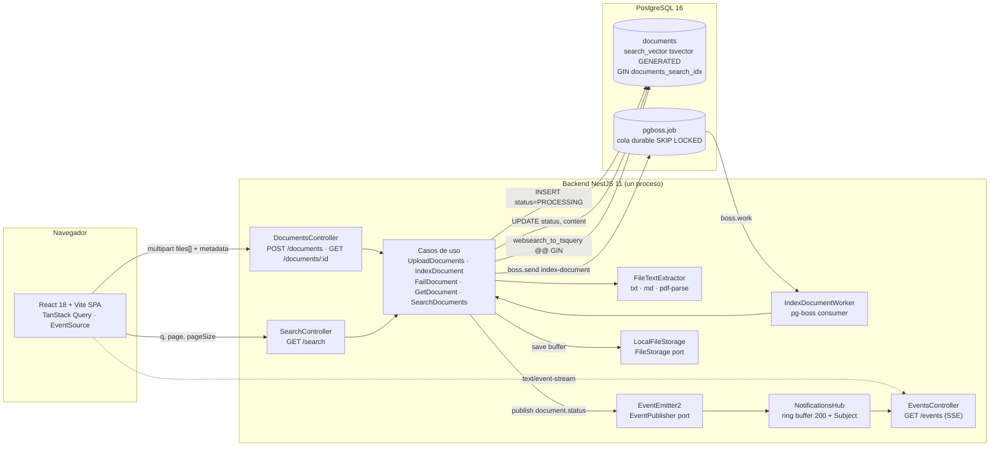
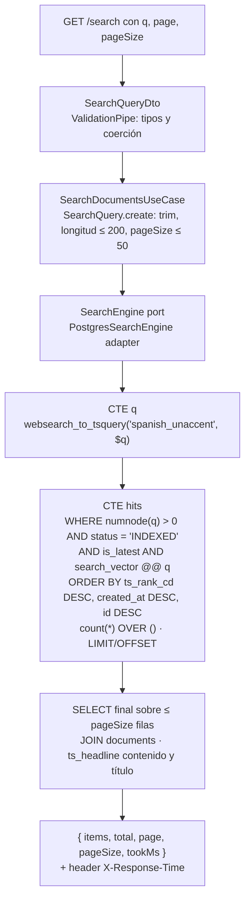
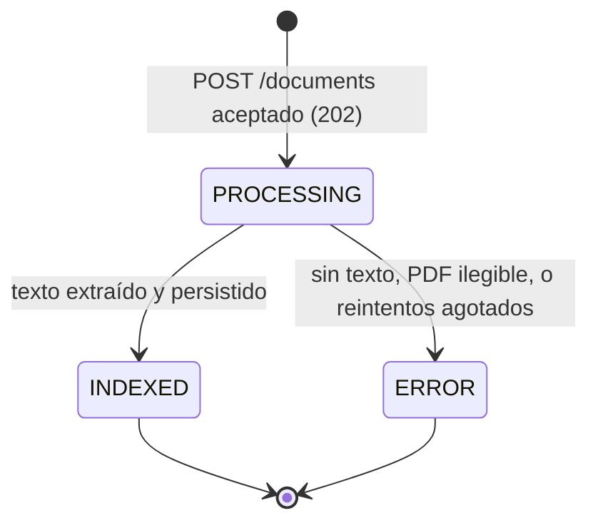

# Arquitectura — Buscador y Visor de Documentos Técnicos

Este documento responde a los cuatro puntos obligatorios del kata (diagrama, justificación de
decisiones, estrategia de tiempo real y escalabilidad) y añade las secciones necesarias para
defender el diseño en la sustentación: estructura del repositorio, flujo de estados, manejo de
errores, pruebas y límites conocidos. Cada afirmación sobre el código cita el archivo donde
puede verificarse.

## 1. Diagrama de arquitectura

### 1.1 Componentes y flujo



Motor de búsqueda y mecanismo de tiempo real no son servicios separados: el motor es el
subsistema FTS de PostgreSQL (`backend/src/search/infrastructure/persistence/postgres-search.engine.ts`)
y el tiempo real es un endpoint SSE del mismo proceso NestJS
(`backend/src/notifications/infrastructure/http/events.controller.ts`). Es una decisión
deliberada (sección 2) y la sección 4 describe cómo separar ambos cuando el volumen lo exija.

### 1.2 Secuencia: carga → job → indexación → SSE → UI


### 1.3 Ruta de una búsqueda



Archivos: `backend/src/search/infrastructure/http/search.controller.ts`,
`backend/src/search/domain/search-query.ts`,
`backend/src/search/application/search-documents.use-case.ts`,
`backend/src/search/infrastructure/persistence/postgres-search.engine.ts`.

## 2. Justificación de decisiones

Todas las decisiones se tomaron comparando alternativas frente a los requisitos del kata:
búsqueda indexada sin `LIKE`, respuesta entre 400 ms y 1 s, notificación en tiempo real sin
polling, entrega en menos de 24 h y una sustentación de 30 minutos. Ninguna se argumenta por
familiaridad con la herramienta.

### 2.1 Interpretación del requisito "entre 400 ms y 1000 ms"

Se interpreta como un SLO de latencia: **p95 ≤ 1 s** medido en el backend, expuesto en el header
`X-Response-Time` y en el campo `tookMs` de la respuesta
(`backend/src/search/infrastructure/http/search.controller.ts`,
`backend/src/search/application/search-documents.use-case.ts`). No se introduce ningún retraso
artificial para "alcanzar" los 400 ms: un sistema que responde en 20 ms cumple el objetivo con
margen, y penalizarlo deliberadamente sería contrario al propósito del requisito. La UI muestra
el `tookMs` en un badge (`frontend/src/features/search/components/LatencyBadge.tsx`) para que el
cumplimiento sea visible en la demo.

### 2.2 Base de datos y motor de búsqueda: PostgreSQL 16 FTS

| Opción | Ventajas | Desventajas | Veredicto |
|---|---|---|---|
| **PostgreSQL 16 FTS** (elegida) | Una sola infraestructura; índice y documento en la misma transacción (sin doble escritura); `tsvector` como columna generada, el índice se mantiene solo; GIN responde en milisegundos a este volumen; `websearch_to_tsquery` acepta frases y exclusiones sin romperse con entrada inválida | Sin tolerancia a errores tipográficos; ranking `ts_rank_cd` menos rico que BM25; `ts_headline` relee el texto; una sola configuración de idioma por columna | Cumple todos los requisitos con el menor riesgo operativo en el plazo |
| Elasticsearch / OpenSearch | BM25, fuzziness, agregaciones, sharding horizontal nativo | Segundo sistema con su propio ciclo de vida; doble escritura o CDC para mantener consistencia; JVM con mínimo de memoria alto para un demo; más superficie para fallar en `docker compose up` | Innecesario a esta escala; ruta de migración documentada en 4.4 |
| Meilisearch / Typesense | Ligero, typo-tolerance, buena DX | Mismo problema de consistencia (doble escritura); ranking menos configurable para pesos por campo; otro contenedor | Descartado por la misma razón de consistencia |
| SQLite FTS5 | Cero infraestructura | Sin concurrencia de escritura real, sin cola durable, inviable para varias réplicas | Descartado |

Implementación (`backend/drizzle/0000_init.sql`, `backend/src/shared/database/schema.ts`):

- Columna `search_vector tsvector GENERATED ALWAYS AS (...) STORED` con pesos `A` título,
  `B` autor + categoría + etiquetas, `C` contenido. PostgreSQL recalcula el vector en cada
  `INSERT`/`UPDATE`: no existe código de aplicación que pueda olvidarse de indexar.
- Índice `documents_search_idx` GIN sobre `search_vector`.
- Configuración de texto propia `spanish_unaccent` (`COPY = spanish`, mapeo
  `word/hword/hword_part → unaccent, spanish_stem`). Es necesaria porque `unaccent()` no es
  `IMMUTABLE` y una columna generada exige expresiones inmutables; en cambio, una
  configuración de búsqueda sí puede usarse dentro de `to_tsvector` en una columna generada.
  Límite conocido: los términos en inglés se indexan como tokens sin stemming.
- `array_to_string` es `STABLE`, no `IMMUTABLE`; se envuelve en `immutable_array_to_string`
  (SQL, `IMMUTABLE PARALLEL SAFE STRICT`) porque para `text[]` el resultado es determinista.
- Consulta (`postgres-search.engine.ts`): `websearch_to_tsquery` (frases entre comillas,
  `-exclusión`, `OR`), `@@` sobre el GIN, `ts_rank_cd` para ordenar, `count(*) OVER ()` para el
  total, y `ts_headline` **solo sobre la página** (a lo sumo `pageSize` filas, máximo 50) gracias
  a la CTE `hits` que devuelve ids. Cuando la consulta contiene solo stopwords (`numnode = 0`)
  el filtro corta antes de consultar el índice.

**Cumplimiento de "prohibido LIKE"**: la búsqueda usa exclusivamente el operador `@@` sobre el
índice GIN (`postgres-search.engine.ts` líneas 78 y 121). Se verificó con una búsqueda de
`\b(i?like)\b` sobre `backend/src`, `backend/test`, `backend/scripts` y `backend/drizzle`: no
existe ningún `LIKE` ni `ILIKE` en SQL; las únicas dos coincidencias son la palabra inglesa
"like" dentro de comentarios.

**Mediciones** (seed de 300 documentos sintéticos, `backend/scripts/seed.ts`):

| Medición | Resultado |
|---|---|
| Suite de integración, 20 consultas variadas sobre 340+ filas (`backend/test/search.integration-spec.ts`, Testcontainers) | p50 18.6 ms · p95 24.6 ms · max 34.6 ms |
| `pnpm --filter backend bench:search`, 200 peticiones, concurrencia 10, contra el stack de `docker compose` (`backend/scripts/bench-search.ts`) | servidor p50 18.7 ms · p95 49.9 ms · p99 58.5 ms · max 61.7 ms · ~330 req/s · 0 errores |
| `EXPLAIN (ANALYZE)` para `kubernetes pod` en el Postgres del stack (304 documentos indexados) | `Bitmap Index Scan on documents_search_idx` → `Bitmap Heap Scan` → `WindowAgg` → `Sort (top-N heapsort)`, 38 coincidencias, ejecución 5.0 ms |
| Consulta solo con stopwords (`de la en`) | `One-Time Filter: false`: la CTE `hits` ni siquiera toca la tabla |

Nota honesta sobre el planificador: con 300 filas y un término frecuente, PostgreSQL elige un
`Seq Scan` porque la tabla cabe en pocas páginas y es más barato que consultar el índice. La
prueba `uses the GIN index documents_search_idx for the hits query` lo contempla: si el plan
natural no usa el índice, repite el `EXPLAIN` con `SET LOCAL enable_seqscan = off` para
demostrar que el índice **es utilizable** para ese predicado (clase de operador y configuración
de texto coinciden), que es lo que importa cuando la tabla crezca. El `EXPLAIN ANALYZE` de
`kubernetes pod` (términos menos frecuentes) sí muestra el `Bitmap Index Scan` sin forzar nada.

### 2.3 Backend: NestJS 11

| Opción | Ventajas | Desventajas |
|---|---|---|
| **NestJS** (elegida) | Inyección de dependencias nativa: los puertos se registran con tokens `Symbol` y los casos de uso se arman con factories sin decoradores (`documents.module.ts`, `search.module.ts`); `ValidationPipe` + class-validator para DTOs; `ExceptionFilter` global como middleware de excepciones; `@Sse()` incorporado; `@nestjs/config` con validación de `.env`; mismo lenguaje que el frontend, lo que habilita `packages/shared` | Más capas que Express para un CRUD; curva de aprendizaje de módulos/providers |
| Express.js | Mínimo, sin opinión | DI, validación, filtros y SSE serían código propio: más superficie a revisar en 24 h |
| FastAPI | Excelente validación con Pydantic, async nativo | Segundo lenguaje en el monorepo; el contrato compartido con el frontend pasaría a OpenAPI generado |
| Spring Boot / Quarkus | Ecosistema maduro, DI potente | Tiempo de arranque y peso de contenedor mayores para la demo; dos lenguajes |

Decisión relacionada: se fijó **NestJS 11 + TypeScript 5.9** en lugar de NestJS 12 porque la
versión 12 es ESM-only y empuja a Vitest; mantener Jest + ts-jest (decisión 8 del plan) era
prioritario para reducir riesgo. Los tests corren con `--experimental-vm-modules` porque
pdf-parse (pdf.js) requiere `import()` dinámico (`backend/package.json`).

### 2.4 Tiempo real: SSE

| Opción | Ventajas | Desventajas |
|---|---|---|
| **SSE** (elegida) | Flujo unidireccional servidor → cliente, que es exactamente el caso (el cliente nunca envía por el canal); HTTP/1.1 plano, atraviesa proxies y CORS como cualquier GET; reconexión automática y `Last-Event-ID` implementados por el navegador en `EventSource`; `@Sse()` en Nest devuelve un `Observable` | Un stream por pestaña (límite de 6 conexiones por host en HTTP/1.1; irrelevante con HTTP/2); solo texto |
| WebSocket | Bidireccional, binario | Protocolo distinto (upgrade), reconexión y reenvío de eventos perdidos a cargo del cliente; requiere `@nestjs/websockets` + adaptador; bidireccionalidad que no se usa |
| GraphQL subscriptions | Integrado si la API fuera GraphQL | La API es REST; añadir GraphQL solo para suscripciones duplica la capa de transporte |
| Polling | Trivial | Prohibido por HU-04; latencia = intervalo; carga proporcional a pestañas abiertas |

La estrategia completa se describe en la sección 3.

### 2.5 Procesamiento asíncrono: pg-boss

| Opción | Ventajas | Desventajas |
|---|---|---|
| **pg-boss** (elegida) | Cola durable en la misma base (`SELECT ... FOR UPDATE SKIP LOCKED`), esquema propio `pgboss`; reintentos con backoff exponencial y expiración configurables (`index-document.job.ts`: `retryLimit 3`, `retryDelay 5`, `expireInSeconds 300`); sobrevive reinicios; el worker puede ejecutarse en otro proceso sin cambiar código | Throughput menor que Redis para millones de jobs; añade carga a Postgres |
| BullMQ + Redis | Muy alto throughput, UI de monitoreo | Segunda infraestructura (Redis) que debe levantar el evaluador; doble punto de fallo |
| In-process (`setImmediate`, cola en memoria) | Cero dependencias | Se pierde con cualquier reinicio; sin reintentos; no escala a varias instancias |

`UploadDocumentsUseCase` responde 202 en cuanto el archivo está en disco, la fila en
`PROCESSING` y el job encolado; la extracción de texto nunca ocurre en la petición HTTP
(`backend/src/documents/application/upload-documents.use-case.ts`).

### 2.6 Frontend: React 18 + Vite SPA

| Opción | Ventajas | Desventajas |
|---|---|---|
| **React + Vite** (elegida) | Herramienta interna sin requisitos de SEO ni SSR: una SPA es la arquitectura honesta; Vite arranca en milisegundos y su proxy `/api` resuelve CORS en desarrollo (`frontend/vite.config.ts`); TanStack Query gestiona caché, invalidación y `keepPreviousData` para la paginación; `EventSource` es nativo | Sin render en servidor (no se necesita) |
| Next.js | SSR/SSG, rutas de API | Servidor Node adicional en producción, complejidad de App Router, y SSR no aporta nada a una herramienta interna autenticada |
| Angular | Framework completo con DI | Más ceremonia; sin ventaja para tres pantallas |

Organización: atomic design en `frontend/src/components/{atoms,molecules,organisms}` y
container/presentational por feature en `frontend/src/features/{upload,search,viewer,notifications}`
(hooks contenedores como `useSearch`, `useDocument`, `useTrackedUploads`, componentes
presentacionales en `components/`). El highlight se renderiza sin `dangerouslySetInnerHTML`:
`frontend/src/lib/highlight.ts` parte el texto en segmentos interpretando únicamente los
tokens literales `<mark>`/`</mark>`.

### 2.7 Arquitectura hexagonal por capacidad de negocio

El backend se organiza por capacidad (`documents`, `search`, `notifications`), y dentro de cada
una por capa `domain / application / infrastructure`. Los decoradores de NestJS existen solo en
`infrastructure/` y en los módulos de composición; `domain/` y `application/` son clases planas
probadas con fakes en memoria (`backend/src/documents/application/__fakes__/`,
`backend/src/search/application/__fakes__/`).

Puertos (interfaces + token `Symbol`) en `backend/src/documents/domain/ports/`:
`DocumentRepository`, `FileStorage`, `TextExtractor`, `JobQueue`, `EventPublisher`,
`IdGenerator`; y en `backend/src/search/domain/ports/search-engine.ts`: `SearchEngine`.
Solo se abstrae lo que realmente varía (almacenamiento, cola, motor, bus): no hay
"repositorio genérico" ni capas intermedias sin contenido.

### 2.8 Acceso a datos: Drizzle ORM

| Opción | Ventajas | Desventajas |
|---|---|---|
| **Drizzle + drizzle-kit** (elegida) | Columna generada e índice GIN declarativos en TypeScript (`schema.ts`); `sql\`\`` tipado para la consulta FTS; migraciones SQL legibles y versionadas en `backend/drizzle/`; sin decoradores en entidades de dominio; ligero sobre node-postgres | Sin `tsvector` nativo (se declara con `customType`); el `execute()` crudo omite los mappers de columna, por eso `created_at` se formatea en SQL |
| Prisma | DX muy buena, cliente generado | `tsvector`/GIN/columnas generadas requieren SQL manual fuera del esquema; motor de consultas aparte |
| TypeORM | Maduro | Entidades con decoradores que contaminarían el dominio; soporte FTS igualmente manual |

### 2.9 Monorepo: pnpm workspaces + `packages/shared`

`pnpm-workspace.yaml` declara `backend`, `frontend` y `packages/*`. `@techdocs/shared`
(`packages/shared/src/index.ts`) contiene el enum `DocumentStatus`, los DTOs de respuesta
(`UploadAcceptedResponse`, `DocumentDetail`, `SearchResponse`, `DocumentStatusEvent`,
`ApiError`) y las constantes de validación (`ALLOWED_EXTENSIONS`, `MAX_FILE_SIZE_BYTES`). Así
el backend y el frontend comparten el contrato por tipo, no por convención. El paquete se
compila a `dist/` con el script `prepare` de la raíz (`package.json`) para que un clon limpio
funcione tras `pnpm install`.

### 2.10 Pruebas: Jest + ts-jest, TDD en el core, Testcontainers para el adaptador FTS

- Dominio y aplicación se desarrollaron escribiendo primero la especificación que falla
  (`*.spec.ts` junto a cada archivo) contra fakes de los puertos.
- El adaptador `PostgresSearchEngine` no tiene sentido probarlo con un fake: lo que se valida
  es el comportamiento real de `tsvector`, `ts_rank_cd`, `ts_headline` y el índice GIN. Por eso
  `backend/test/search.integration-spec.ts` levanta `postgres:16-alpine` con Testcontainers (o
  usa `TEST_DATABASE_URL`), corre las migraciones reales e inserta 300 documentos generados más
  fixtures escritos a mano.
- Detalle en la sección 7.

## 3. Estrategia de tiempo real

### 3.1 Flujo de un evento

1. `IndexDocumentUseCase` (o `FailDocumentUseCase`) persiste el estado final y llama
   `publisher.publish(DocumentStatusEvent)` a través del puerto `EventPublisher`
   (`backend/src/documents/domain/ports/event-publisher.ts`).
2. El adaptador `EventEmitterPublisher` emite `document.status` en `EventEmitter2`
   (`backend/src/documents/infrastructure/events/event-emitter.publisher.ts`). Las capacidades
   `documents` y `notifications` solo comparten el nombre del evento y el tipo
   `DocumentStatusEvent` de `@techdocs/shared`.
3. `DocumentStatusListener` (`@OnEvent('document.status')`) reenvía el evento al
   `NotificationsHub` (`backend/src/notifications/infrastructure/events/`).
4. `NotificationsHub.publish` lo inserta en `EventReplayBuffer` (ring buffer de 200 entradas con
   id monótono, `backend/src/notifications/domain/event-replay-buffer.ts`) y lo emite por un
   `Subject` de RxJS.
5. `EventsController` (`@Sse('events')`) devuelve, por conexión,
   `merge(concat(from(replayed), hub.live$), heartbeat$)`.

### 3.2 Reconexión y `Last-Event-ID`

- Cada evento `document.status` lleva `id: <secuencia>`. El navegador lo guarda y, al
  reconectar, envía el header `Last-Event-ID`; el controlador responde primero con
  `hub.replay(lastEventId)` (lo perdido mientras estuvo desconectado, acotado por la capacidad
  del buffer) y después con el flujo en vivo. La concatenación es síncrona, así que nada
  publicado entre ambas fases se pierde.
- **Heartbeat cada 15 s** (`DEFAULT_HEARTBEAT_INTERVAL_MS`). Mantiene vivas conexiones
  inactivas frente a proxies y balanceadores que cierran sockets silenciosos. Lleva como `id` el
  último id del hub: NestJS asigna un contador propio por conexión a los mensajes sin `id`, lo
  que corrompería el `Last-Event-ID` del cliente; con el id real el heartbeat significa "estás
  al día hasta aquí", y una reconexión tras un periodo tranquilo reproduce exactamente lo
  ocurrido desde entonces.
- Un `Last-Event-ID` ausente o malformado se trata como `null`: el cliente recibe solo eventos
  en vivo (`parseLastEventId`).
- Headers `Content-Type: text/event-stream`, `Cache-Control: no-cache, no-store` y
  `X-Accel-Buffering: no` los fija el propio soporte SSE de Nest.

### 3.3 Comportamiento del frontend

`frontend/src/features/notifications/useDocumentEvents.ts`, montado una sola vez por
`DocumentEventsProvider`:

- Abre un único `EventSource` a `/events` (`frontend/src/api/events.ts`). La reconexión y el
  reenvío de `Last-Event-ID` son nativos del navegador; el hook solo recrea el stream si el
  navegador lo marca `CLOSED` (por ejemplo, una respuesta no reintentable), tras 5 s.
- Al recibir `document.status`: parchea de inmediato la entrada `DocumentDetail` en la caché de
  TanStack Query (cambia el badge en todas las pantallas), invalida esa consulta (para traer
  contenido y metadatos finales) e invalida las búsquedas (`queryKeys.searches`), y muestra un
  toast (éxito para `INDEXED`, error persistente para `ERROR`).
- Expone el estado de conexión (`connecting | open | reconnecting | closed`) para la UI.
- `useTrackedUploads` (`frontend/src/features/upload/useTrackedUploads.ts`) guarda en
  `sessionStorage` los ids aceptados en la pestaña (máximo 50) y los consulta una vez al montar,
  cubriendo eventos perdidos mientras la pestaña estuvo cerrada.
- Red de seguridad: `useDocument` (`frontend/src/features/viewer/useDocument.ts`) refresca cada
  15 s **solo mientras** el documento está en `PROCESSING`; con SSE operativo ese intervalo
  nunca se alcanza, y no sustituye la notificación inmediata exigida por HU-04.

### 3.4 Por qué no polling y por qué no WebSocket aquí

Polling queda prohibido por el enunciado y, además, acopla latencia a intervalo y carga a
número de pestañas. WebSocket resolvería el mismo problema, pero obligaría a implementar en el
cliente la reconexión y la recuperación de eventos perdidos, que `EventSource` ya trae; y la
bidireccionalidad que lo justifica no existe en este caso de uso: el cliente nunca envía nada
por el canal. SSE es la opción más simple que cumple HU-04 por completo.

## 4. Escalabilidad ante incremento masivo de documentos

El principio rector: **el dominio y la capa de aplicación no cambian**; cada punto de escala
es un adaptador nuevo detrás de un puerto existente o una decisión de despliegue.

### 4.1 Lectura: réplicas y particionado

- Réplicas de lectura en streaming: `GET /search` y `GET /documents/:id` son solo lectura y
  pueden apuntar a réplicas; escrituras (`INSERT`/`UPDATE` del worker) al primario. El índice
  GIN se replica con el WAL sin trabajo adicional.
- Particionado declarativo de `documents` por `category` o por rango de `created_at` cuando la
  tabla supere decenas de millones de filas; cada partición tiene su propio GIN y el planificador
  poda particiones si el filtro lo permite.
- `ts_headline` ya se ejecuta solo sobre la página (CTE `hits` → ids → `JOIN`), de modo que su
  costo es O(`pageSize`) y no O(coincidencias). Con documentos muy grandes conviene además
  acotar el `content` que se pasa a `ts_headline` (por ejemplo, los primeros N KB) porque la
  función relee el texto completo.
- `count(*) OVER ()` cuenta todas las coincidencias; por encima de ~10^5 resultados debe
  sustituirse por una estimación (`EXPLAIN` del planificador, o contar hasta un tope y mostrar
  "más de N") para que el total no domine la latencia.

### 4.2 Escritura e indexación: worker separado

`IndexDocumentWorker` es un provider más del proceso API
(`backend/src/documents/infrastructure/queue/index-document.worker.ts`). Como pg-boss toma
jobs con `SKIP LOCKED`, basta arrancar un segundo proceso que importe solo `DocumentsModule`
sin controladores para tener N workers compitiendo por la cola, y escalar sus réplicas con
independencia de la API. Es especialmente relevante para PDF: pdf-parse consume CPU en el event
loop, y aislarlo en procesos dedicados evita que la extracción degrade la latencia de búsqueda.

### 4.3 Almacenamiento de archivos: S3/MinIO

`LocalFileStorage` implementa `FileStorage` (`save`, `read`) en disco local. Un adaptador
`S3FileStorage` con la misma interfaz permite varias instancias de API y workers sin disco
compartido; se registra cambiando una línea en `documents.module.ts`
(`{ provide: FILE_STORAGE, useClass: ... }`).

### 4.4 Motor de búsqueda: migración a Elasticsearch/OpenSearch

Cuándo migrar: cuando se necesite tolerancia a errores tipográficos, ranking BM25 ajustable,
agregaciones/facetas, o cuando el volumen supere lo que una instancia de Postgres sirva en SLO
incluso con réplicas y particionado.

Cómo, sin reescribir la aplicación:

1. PostgreSQL sigue siendo la fuente de verdad de `documents`.
2. Se añade una tabla outbox (o CDC con Debezium sobre el WAL) que publique cada cambio de
   `INDEXED`/`ERROR`; un consumidor indexa en Elasticsearch de forma idempotente.
3. Se implementa `ElasticsearchSearchEngine` con la interfaz `SearchEngine`
   (`backend/src/search/domain/ports/search-engine.ts`) y se cambia el binding en
   `backend/src/search/search.module.ts`. `SearchDocumentsUseCase`, `SearchQuery`, el DTO y el
   controlador no cambian; `tookMs` sigue midiendo la llamada al puerto.
4. Durante la transición ambos adaptadores pueden convivir detrás de un flag para comparar
   resultados.

### 4.5 Tiempo real con varias instancias

`NotificationsHub` es local al proceso: solo ve eventos producidos por esa instancia. Con N
réplicas de API detrás de un balanceador, el worker que indexa puede no ser la instancia a la
que el navegador está conectado. La solución es un canal compartido detrás del mismo hub:

- Postgres `LISTEN/NOTIFY`: cero infraestructura nueva; cada instancia hace `LISTEN
  document_status` y el worker `NOTIFY` tras el `UPDATE`. Límite: payload de 8 KB y sin
  persistencia (lo cubre el ring buffer por instancia + el GET inicial de `useTrackedUploads`).
- Redis Pub/Sub si ya existiera Redis en la plataforma.

En ambos casos cambia únicamente el adaptador de `EventPublisher` (publicar al canal en lugar de
a `EventEmitter2`) y la fuente del `DocumentStatusListener`; el controlador SSE, el buffer y el
frontend no se tocan. Para que el `Last-Event-ID` sea coherente entre instancias habría que
pasar del contador en memoria a una secuencia de base de datos.

### 4.6 Resumen: qué cambia y qué no

| Presión | Cambia | No cambia |
|---|---|---|
| Más lecturas | Réplicas, particionado, tope en `ts_headline`, conteo estimado | Caso de uso, DTO, controlador |
| Más PDFs / más carga de indexación | Worker en proceso propio, réplicas del worker | `IndexDocumentUseCase`, dominio |
| Varias instancias de API | `S3FileStorage`, `EventPublisher` sobre LISTEN/NOTIFY o Redis | Puertos, `EventsController`, frontend |
| Relevancia o fuzziness | `ElasticsearchSearchEngine` vía outbox/CDC | `SearchDocumentsUseCase`, `SearchQuery`, Postgres como fuente de verdad |

## 5. Estructura del repositorio

| Ruta | Capa / responsabilidad |
|---|---|
| `packages/shared/src/index.ts` | Contrato compartido: enum de estados, DTOs, eventos SSE, constantes de validación |
| `backend/src/main.ts`, `backend/src/app.module.ts` | Bootstrap: CORS, `ValidationPipe` global (`whitelist`, `forbidNonWhitelisted`, `transform`), `HttpExceptionFilter` global, shutdown hooks; módulos raíz |
| `backend/src/shared/config/env.schema.ts` | Esquema zod del `.env`; falla al arrancar listando cada variable inválida |
| `backend/src/shared/http/http-exception.filter.ts` | Filtro global que normaliza todo error al contrato `ApiError` |
| `backend/src/shared/database/` | Pool node-postgres, Drizzle, esquema declarativo con `tsvector` y GIN, runner de migraciones |
| `backend/src/shared/queue/` | Provider global de pg-boss (esquema `pgboss`) |
| `backend/drizzle/*.sql` | Migraciones SQL versionadas (`0000_init.sql`, `0001_document_file_name.sql`, `0002_document_versioning.sql`) |
| `backend/src/documents/domain/` | Agregado `Document` con transiciones, errores con `code` estable, puertos |
| `backend/src/documents/application/` | `UploadDocuments`, `IndexDocument`, `FailDocument`, `GetDocument`, `SweepStaleDocuments`, `SweepOrphanFiles`, mappers, fakes |
| `backend/src/documents/infrastructure/` | Controlador multipart, DTOs class-validator, filtro de errores de dominio, repositorio Drizzle y `DrizzleUnitOfWork`, almacenamiento local, extractor pdf-parse, cola (transaccional) y worker pg-boss, sweeper programado, publisher EventEmitter2 |
| `backend/src/inspection/` | Capacidad de inspección previa a la carga: `MetadataSuggestion` (sanitización), puerto `MetadataExtractor`, `InspectFilesUseCase`, extractores PDF/Markdown/texto y `POST /documents/inspect` |
| `backend/src/search/` | `SearchQuery` (value object), puerto `SearchEngine`, `SearchDocumentsUseCase`, controlador y `PostgresSearchEngine` |
| `backend/src/notifications/` | `EventReplayBuffer` (dominio), `NotificationsHub`, listener, `EventsController` SSE |
| `backend/src/health/` | `GET /health` con sonda a la base; 503 si está caída |
| `backend/test/search.integration-spec.ts`, `backend/test/documents-versioning.integration-spec.ts`, `backend/test/documents-atomicity.integration-spec.ts` | Integración FTS, versionado (backfill, índices, `is_latest`) y atomicidad (transacción compartida con pg-boss, lock por clave, sweeper) con Testcontainers |
| `backend/scripts/` | `migrate.ts`, `seed.ts` (300 docs), `synthetic-documents.ts`, `bench-search.ts`, `generate-sample-pdfs.ts` |
| `frontend/src/app/` | Router (`/upload`, `/search`, `/documents/:id`), providers (QueryClient, toasts, SSE) |
| `frontend/src/api/` | Cliente `fetch` tipado con `ApiError`, `EventSource` |
| `frontend/src/features/{upload,search,viewer,notifications}/` | Hooks contenedores + componentes presentacionales por feature |
| `frontend/src/components/{atoms,molecules,organisms}/` | Atomic design |
| `frontend/src/lib/` | `highlight.ts`, `status.ts`, `queryKeys.ts`, `format.ts` |
| `frontend/src/features/upload/suggestions.ts` | Reglas puras del prellenado (`applySuggestion`, `recordUserEdit`, pistas de origen) |
| `docs/` | `architecture.md`, `ia.md`, `ia-log.md`, `samples/` |

## 6. Flujo de estados



- Las transiciones viven en el agregado (`backend/src/documents/domain/document.ts`):
  `markIndexed` y `markFailed` solo son válidas desde `PROCESSING`; cualquier otra lanza
  `DocumentStateError` (HTTP 409 si llegara a un controlador). `markFailed` borra `content`
  para que una fila en `ERROR` nunca exponga texto a medio indexar.
- `IndexDocumentUseCase` distingue fallos deterministas (misma entrada, mismo resultado: PDF sin
  texto, parseo fallido) que terminan en `ERROR` sin reintento, de fallos transitorios
  (persistencia) que propagan la excepción para que pg-boss reintente.
- Agotamiento de reintentos: el worker detecta el último intento
  (`job.retryCount >= retryLimit`) y, antes de relanzar el error, invoca `FailDocumentUseCase`
  con un motivo de dominio sanitizado (máximo 300 caracteres): nunca incluye la query, sus
  parámetros ni el contenido. El detalle interno (incluida la causa de Postgres) queda en el
  log, con los `params` de Drizzle redactados y solo los frames del stack. Si el texto supera
  el límite de 1 MB de `tsvector`, el usuario ve un mensaje accionable en lugar del error de
  la base. Así un job agotado nunca deja un documento en `PROCESSING` sin evento de estado
  (`index-document.worker.ts`, `fail-document.use-case.ts`). Los fallos de extracción y de
  almacenamiento en el primer intento también guardan un motivo público sanitizado
  (`indexing-failure.ts`) y registran el detalle interno a través del logger del caso de uso.
- El job es idempotente: si el documento ya no está en `PROCESSING`, se retorna sin tocarlo.
- La UI traduce los estados a `PROCESANDO / INDEXADO / ERROR` (`frontend/src/lib/status.ts`).

## 6b. Versionado por contenido

Segunda iteración, posterior a la entrega inicial del kata. Objetivo: que subir dos veces el
mismo archivo no cree dos documentos, y que subir una nueva edición de la misma obra la agrupe
con las anteriores en lugar de aparecer como un resultado más en la búsqueda. El alcance se
mantuvo mínimo a propósito: ninguna ruta nueva, ningún estado nuevo, ninguna transición nueva.

### 6b.1 Tres conceptos, tres columnas

| Concepto | Columna | Definición | Dónde |
|---|---|---|---|
| Identidad | `document_key` | `normalize(title) + '\|' + normalize(author)`: NFD y eliminación de diacríticos, minúsculas, `trim`, espacios colapsados a uno | `backend/src/documents/domain/document-key.ts` (`buildDocumentKey`); backfill SQL en `backend/drizzle/0002_document_versioning.sql` con `btrim(regexp_replace(lower(unaccent(...)), '\s+', ' ', 'g'))` |
| Huella | `content_hash` | SHA-256 (hex) de los **bytes** del archivo, calculado en la petición que responde 202 | `upload-documents.use-case.ts` (`sha256(upload.file.buffer)`) |
| Versión | `version` (ya existía) + `is_latest` | Metadato semver que exige el kata; `is_latest` marca la versión vigente de cada identidad | `backend/src/documents/domain/semver.ts`, `document.ts` (`supersede()`) |

**Por qué la identidad es título + autor y no el hash.** El hash identifica bytes, no obras:
dos ediciones del mismo manual tienen hashes distintos y deben agruparse; el mismo archivo con
otro título es, para el usuario, otro documento. La identidad tiene que salir de lo que el
usuario declara. Se normaliza para que "Guía Técnica" y "guia tecnica" coincidan, pero **no** se
corrige ortografía: un typo en el título crea otra identidad, y eso se prueba de forma
explícita (`upload-documents.use-case.spec.ts`) porque es un límite que el evaluador puede
preguntar.

**Por qué la huella es de los bytes y no del texto extraído.** El 202 es inmediato: el caso de
uso responde en cuanto el archivo está en disco y la fila en `PROCESSING`; el texto extraído
solo existe después, en el worker. Un hash del texto obligaría a extraer en la petición HTTP
(rompiendo la decisión 2.5) o a detectar el duplicado cuando el documento ya fue creado y
encolado. El hash de bytes es determinista, síncrono y barato (un `createHash` sobre un buffer
que ya está en memoria). Consecuencia aceptada: la misma obra en `.txt` y en `.pdf` tiene
huellas distintas y se trata como nueva versión.

**La normalización TS y SQL deben coincidir.** El backfill de filas anteriores a la migración
se hace en SQL con `unaccent`, y las filas nuevas se calculan en TypeScript con NFD. La prueba
`backfills document_key with the same normalization as buildDocumentKey`
(`backend/test/documents-versioning.integration-spec.ts`) inserta títulos con acentos,
mayúsculas y espacios irregulares y comprueba que ambas rutas producen la misma clave.

### 6b.2 Semver tolerante y versión efectiva

`semver.ts` acepta `v`/`V` inicial, núcleo de uno a tres componentes (`1` → `1.0.0`,
`1.2` → `1.2.0`) y prerelease (`-beta`, `-rc.1`, que ordena por debajo de su release). Lo que
no se puede interpretar no es un error: ordena por debajo de todo lo interpretable y
`bumpPatch` lo trata como `0.0.0` → `0.0.1`. Una versión de texto libre nunca rompe la carga.

Versión efectiva (`resolveEffectiveVersion`, `upload-documents.use-case.ts`):
`efectiva = max(enviada, bumpPatch(última))`. Si la enviada es mayor o igual que el siguiente
patch de la última, se respeta tal cual (`v2.0.0` se guarda como `v2.0.0`); si no, se asigna
`bumpPatch(última)` y el ítem del 202 lo informa en `version`. La primera versión de una
identidad es siempre la enviada. **La versión nunca retrocede**, aunque el usuario reenvíe
`1.0.0` sobre una `1.0.3`.

### 6b.3 Reglas de carga

Solo se consulta la **última versión vigente** de la identidad (`findLatestByKey`); las
versiones ya reemplazadas nunca influyen en la decisión.

| Situación al subir un archivo | Resultado | Ítem del 202 |
|---|---|---|
| Misma identidad, mismos bytes que la última versión y esa versión **no** está en `ERROR` | **Duplicado**: no se crea fila, archivo ni job | `{ id: <existente>, status: <existente>, version: <existente>, duplicateOf: { id, version } }` |
| Misma identidad, mismos bytes, pero la última versión está en `ERROR` | **Reintento** como nueva versión (la indexación anterior falló; volver a intentarlo es legítimo) | `{ id: <nuevo>, status: PROCESSING, version: <efectiva> }` |
| Misma identidad, bytes de una versión **antigua** ya reemplazada | **Rollback** como nueva versión: el historial sigue siendo lineal y la "vuelta atrás" queda registrada | igual que la fila anterior |
| Misma identidad, bytes distintos | **Nueva versión**: la anterior pasa a `is_latest = false` (`supersede()`), la nueva es `is_latest = true` | igual que la fila anterior |
| Identidad nueva | **Documento nuevo**, `is_latest = true` | `{ id, status: PROCESSING, version: <enviada> }` |

Orden de efectos para una versión nueva: `storage.save` → (en una sola transacción, bajo un
lock por identidad) `repository.save(nueva)` → `supersede()` + `repository.update(anterior)` →
`enqueueIndexDocument`. El reemplazo de la anterior ocurre **después** de insertar la nueva para
que un fallo en el insert nunca deje una identidad sin versión vigente. Desde la tercera
iteración los tres pasos de base de datos comparten una transacción (sección 6c): si cualquiera
falla, no queda fila, ni reemplazo, ni job, y el archivo se borra.

**Por qué "mismo contenido" no es un patch.** La primera propuesta del candidato fue que el
mismo archivo reenviado generara automáticamente una versión patch. Se descartó tras discutirlo:
un patch sin cambio de bytes es un número sin significado, la carga masiva dejaría de ser
idempotente (cada reintento de un lote crearía versiones nuevas) y la búsqueda no ganaría nada.
El duplicado es, por tanto, una respuesta informativa (`duplicateOf`) y no un error ni una
versión. La única excepción es la última versión en `ERROR`: ahí el mismo contenido sí crea una
versión nueva, porque lo que se repite es el intento de indexar, no el documento.

### 6b.4 Persistencia, búsqueda y visor

- **Índices** (`0002_document_versioning.sql`): `documents_key_latest_idx` parcial sobre
  `(document_key) WHERE is_latest`, que es exactamente lo que consulta `findLatestByKey` y
  mantiene el índice del tamaño del número de identidades, no de versiones; y
  `documents_key_hash_idx` compuesto `(document_key, content_hash)`, que respalda
  `findByKeyAndHash`. Este último método se conserva en el puerto pero ya no decide el
  duplicado (la regla pasó a depender de la última versión, no de cualquier versión).
- **Búsqueda** (`postgres-search.engine.ts`): `AND d.is_latest` tanto en la CTE `hits` como
  en `countMatches`, para que `total` y la página cuenten lo mismo. Las versiones reemplazadas
  siguen siendo legibles por `GET /documents/:id`, pero salen de los resultados. Prueba:
  `search returns only the latest version of a document key` (dos versiones → un solo hit, la
  última).
- **Detalle** (`get-document.use-case.ts`): `DocumentDetail` incluye `documentKey`,
  `contentHash`, `isLatest` y `versions` (todas las versiones de la identidad, la más reciente
  primero, vía `listVersionsByKey`).
- **Frontend**: en la lista de cargas (`TrackedUploadsList.tsx`) un duplicado se muestra con
  badge neutral "Duplicado", el texto "Ya existía como versión X" y enlace al documento
  existente; si la versión efectiva difiere de la enviada se muestra "Versión asignada: vX
  (enviada vY)". En el visor, `MetadataPanel.tsx` lista las versiones con la actual marcada y
  enlaces a cada una, y `OutdatedVersionBanner.tsx` muestra "Existe una versión más reciente"
  con enlace a la vigente cuando `isLatest === false`.

### 6b.5 Límites de esta iteración

- `unaccent` (SQL) y NFD (TypeScript) coinciden para los diacríticos del español, pero no para
  letras sin descomposición canónica (`ø`, `ß`, `æ`): `unaccent` las transforma y NFD no. Una
  fila anterior a la migración con esas letras en el título podría no agruparse con una carga
  nueva. Afecta solo al backfill; las filas nuevas usan siempre la ruta TypeScript.
- Las filas anteriores a la migración conservan `content_hash = ''` (los bytes originales no se
  releen al migrar): nunca se detectan como duplicado, y la primera recarga crea una versión
  nueva sobre ellas.
- Los dos límites que esta iteración dejó abiertos (dos cargas concurrentes de la misma identidad
  podían quedar ambas con `is_latest = true`; un archivo huérfano si el proceso caía entre
  `storage.save` y el insert) se cerraron en la tercera iteración: lock por identidad y barrido
  de huérfanos (sección 6c).

## 6c. Atomicidad de la carga y recuperación

Tercera iteración. Cierra el límite estructural que quedó documentado en la primera entrega:
el `INSERT` en `documents` y el `send` a pg-boss no compartían transacción, así que un crash
entre ambos dejaba una fila en `PROCESSING` sin job y sin nadie que la rescatara. Alcance:
ninguna ruta nueva, ningún estado nuevo; cambia **cómo** se escribe, no **qué** se escribe.

### 6c.1 Por qué una sola transacción (y no un outbox)

La cola **ya vive en Postgres**: un job de pg-boss es una fila en `pgboss.job`. pg-boss 12
acepta `send(name, data, { db })` con un adaptador `Db` externo, y para esa sentencia usa ese
adaptador en lugar de su propio pool (`manager.js#createJob`). Por tanto, si la fila de
`documents` y la fila de `pgboss.job` se escriben por la **misma conexión** dentro de un `BEGIN`,
las dos se confirman o las dos se descartan. No hace falta una tabla intermedia.

| Opción | Cómo | Veredicto |
|---|---|---|
| **Transacción única con pg-boss** (elegida) | Un puerto `UnitOfWork.run(fn)` abre la transacción; dentro, repositorio y cola operan sobre la misma conexión | Elimina la ventana "fila sin job" con una sola fuente de verdad y sin tablas nuevas; el coste es plomería en infraestructura (Drizzle y pg-boss compartiendo el cliente) |
| Outbox clásico | Tabla `outbox` escrita en la misma transacción y un publicador que la lee y encola | Patrón reconocible, pero sería una segunda cola delante de una cola que ya está en Postgres: más código, más latencia (un salto más antes del worker), y la misma garantía que ya da la transacción compartida. Se descartó |

### 6c.2 El puerto y el adaptador

- **Puerto** (`backend/src/documents/domain/ports/unit-of-work.ts`): `UnitOfWork.run(fn)`
  entrega a `fn` un `TransactionContext` con tres cosas ligadas a la misma transacción: un
  `DocumentRepository`, un `JobQueue` y `lockDocumentKey(documentKey)`. El dominio y la
  aplicación no saben qué hay detrás; los fakes de los specs implementan la misma interfaz.
- **Adaptador** (`backend/src/documents/infrastructure/persistence/drizzle-unit-of-work.ts`,
  `DrizzleUnitOfWork`): toma un `PoolClient` del `pg.Pool` público de Drizzle
  (`Database.$client.connect()`), emite `BEGIN`, y construye dos vistas de **esa misma
  conexión**: `drizzle(client, { schema })` para un `DrizzleDocumentRepository` sin cambios, y
  `{ executeSql: (text, values) => client.query(text, values) }`, el adaptador `Db` que pg-boss
  acepta en `send` (`TransactionalPgBossJobQueue`, `pg-boss-job.queue.ts`). Si `fn` lanza,
  `ROLLBACK` y se relanza; si no, `COMMIT`; en ambos casos `client.release()` en `finally`. Se
  evita a propósito el campo privado `tx.session.client` de `NodePgTransaction`: todo pasa por
  API pública de Drizzle, pg y pg-boss.

### 6c.3 Lock por identidad y relectura bajo el lock

`lockDocumentKey` ejecuta `SELECT pg_advisory_xact_lock(hashtext($1))` con el `document_key`.
El lock es de transacción: se libera con el `COMMIT` o el `ROLLBACK`, nunca hay que soltarlo a
mano. Dentro del lock, `acceptUnderLock` (`upload-documents.use-case.ts`) **vuelve a leer** la
última versión (`findLatestByKey`) y decide con ese valor: duplicado, nueva versión o documento
nuevo. La lectura previa al lock es solo un atajo (un duplicado evidente no escribe archivo ni
abre transacción); la decisión que cuenta es la de dentro. Así dos cargas concurrentes de la
misma identidad se serializan: la segunda ve la fila que la primera confirmó, y queda exactamente
un `is_latest`. Prueba de integración: `serializes two concurrent uploads of the same key:
versions 1.0.0 and 1.0.1, exactly one latest`.

`hashtext` colapsa la clave a un entero de 32 bits; una colisión solo serializa dos identidades
sin relación entre sí (una espera a la otra), nunca altera la corrección.

### 6c.4 Orden de efectos

```mermaid
sequenceDiagram
  autonumber
  participant UP as UploadDocumentsUseCase
  participant FS as LocalFileStorage
  participant UoW as DrizzleUnitOfWork
  participant PG as PostgreSQL (misma conexión)

  UP->>UP: documentKey, sha256(bytes); findLatestByKey (atajo de duplicado)
  UP->>FS: save(uuid.ext, buffer)   [fuera de la transacción]
  UP->>UoW: run(fn)
  UoW->>PG: BEGIN
  UoW->>PG: SELECT pg_advisory_xact_lock(hashtext(document_key))
  UoW->>PG: SELECT ... WHERE document_key = $1 AND is_latest   [relectura bajo el lock]
  alt misma huella que la última y no ERROR
    UoW-->>UP: duplicateOf (sin escrituras)
    UP->>FS: delete(uuid.ext)
  else nueva versión o documento nuevo
    UoW->>PG: INSERT documents (PROCESSING, is_latest = true)
    UoW->>PG: UPDATE documents SET is_latest = false WHERE id = anterior
    UoW->>PG: INSERT pgboss.job (index-document)   [send con db externo]
    UoW->>PG: COMMIT
    UoW-->>UP: { id, status, version }
  end
  opt cualquier paso falla
    UoW->>PG: ROLLBACK
    UP->>FS: delete(uuid.ext)   [best effort, warn si falla]
  end
```

1. El archivo se escribe **antes** de la transacción, fuera de ella: el disco no participa en
   el `ROLLBACK`, y mantener una transacción abierta mientras se escriben hasta 10 MB alargaría el
   lock sin motivo. `storageKey` es `<uuid>.<ext>`, así que la escritura es idempotente.
2. Si la unidad de trabajo falla, `deleteQuietly` borra el archivo; si el borrado también falla
   se registra un `warn` y lo recoge el barrido de huérfanos. Lo mismo si la relectura bajo el
   lock concluye que otra carga concurrente ya escribió los mismos bytes: el archivo recién
   guardado sobra y se borra.
3. El único hueco que la transacción no cubre es un crash **entre** 1 y 3: queda un archivo sin
   fila. No queda nunca una fila sin job.

### 6c.5 `markFailedIfProcessing`: cierre de la carrera check-then-write

`FailDocumentUseCase` (`fail-document.use-case.ts`) ya no lee el estado, comprueba y escribe:
delega en `DocumentRepository.markFailedIfProcessing(id, reason, at)`, que en Drizzle es un solo
`UPDATE documents SET status = 'ERROR', error_message, content = NULL, updated_at WHERE id = $1
AND status = 'PROCESSING' RETURNING id` (`drizzle-document.repository.ts`). Devuelve `true` solo
si una fila cambió; en ese caso se publica el evento SSE. Si entre tanto el worker escribió
`INDEXED`, el `UPDATE` no toca nada, no se publica nada y el resultado correcto gana. La
condición la evalúa Postgres de forma atómica, así que vale con varios workers y con el sweeper
corriendo a la vez. Prueba: `markFailedIfProcessing on an INDEXED row returns false and changes
nothing`.

### 6c.6 El sweeper

`StaleDocumentsSweeper` (`backend/src/documents/infrastructure/sweeper/stale-documents.sweeper.ts`)
no usa `@Interval` de Nest sino `boss.schedule(SWEEP_QUEUE, cron)`: la fila del cron vive en la
base, así que con varias réplicas de la API se crea **un** job por tick y lo procesa una sola;
la cola es `singleton` (`policy: 'singleton', retryLimit: 0`) para que un barrido lento no se
acumule, y la siguiente ocurrencia es el reintento. Cada tick ejecuta dos casos de uso:

| Caso de uso | Qué hace | Umbral |
|---|---|---|
| `SweepStaleDocumentsUseCase` (`sweep-stale-documents.use-case.ts`) | `findStaleProcessing(now - umbral)` → por cada fila, `FailDocumentUseCase.execute(id, 'Indexing timed out')` (el `UPDATE` condicional anterior, con evento SSE). Un fallo en un documento se registra y no detiene el resto | `STALE_PROCESSING_MINUTES` (por defecto 15; `env.schema.ts`). Está muy por encima de la ventana de reintentos del job (3 reintentos con backoff + `expireInSeconds: 300`), para no competir con un worker vivo |
| `SweepOrphanFilesUseCase` (`sweep-orphan-files.use-case.ts`) | `storage.listKeysOlderThan(now - 60 min)` → `repository.existsByStorageKeys(claves)` → borra las que no tienen fila | 60 minutos (`ORPHAN_FILE_MINUTES` en `documents.module.ts`). La edad deja fuera las cargas en vuelo (archivo escrito, transacción aún sin confirmar) |

Frecuencia: `SWEEP_CRON` (por defecto `*/5 * * * *`). Ambas variables están en
`backend/.env.example` y las valida el esquema zod al arrancar.

### 6c.7 Límites de esta iteración

- El umbral del sweeper asume que ninguna indexación legítima dura más de
  `STALE_PROCESSING_MINUTES`; si un PDF enorme superara ese tiempo con el job aún activo, el
  sweeper lo marcaría `ERROR` y el worker, al terminar, encontraría la fila fuera de
  `PROCESSING` y la dejaría tal cual (el job es idempotente). La mitigación es subir la variable;
  la solución completa sería consultar `pgboss.job` antes de marcar.
- El lock por `hashtext` puede serializar dos identidades distintas por colisión de hash (ver
  6c.3). Es una pérdida de paralelismo, no de corrección.
- El archivo huérfano por crash entre `storage.save` y la transacción sigue existiendo hasta una
  hora; es el precio de no meter el disco en la transacción.

## 6d. Metadata sugerida (inspección previa a la carga)

Tercera iteración. Antes, el usuario escribía título, autor y versión a mano por cada archivo;
con el versionado por identidad (6b), un error de tipeo se convierte en otro documento. Ahora el
formulario se prellena con lo que el archivo ya declara.

### 6d.1 Endpoint y contrato

`POST /documents/inspect` (`backend/src/inspection/infrastructure/http/inspection.controller.ts`):
multipart con solo las partes `files` (sin `metadata`), mismos límites que la carga (20 archivos,
10 MB, `defParamCharset: 'utf8'`), responde `200` con `InspectResponse` y **no persiste nada**
(ni fila, ni archivo, ni job). Por archivo (`packages/shared/src/index.ts`, `InspectedFile`):
`{ fileName, format, sizeBytes, pages?, source: 'pdf-info' | 'front-matter' | 'heuristic' |
'none', suggested: { title?, author?, category?, tags?, version? } }`. Los errores reutilizan
`DomainErrorFilter` de `documents` (400 formato no soportado, 413 demasiado grande), así que el
frontend trata ambos endpoints igual.

Se eligió un endpoint separado y no "enriquecer en el worker": el worker corre después del 202,
cuando el `document_key` ya se calculó con lo que el usuario tipeó; el problema de fondo es la
entrada manual y solo se resuelve antes de enviar.

### 6d.2 Puerto y fuentes

Capacidad propia `backend/src/inspection/` con la misma división hexagonal. Puerto
`MetadataExtractor.inspect(buffer, format, fileName)` (`domain/ports/metadata-extractor.ts`)
con el contrato de **no lanzar nunca** por contenido malformado: se degrada al fallback.
`FormatDispatchingMetadataExtractor` elige el adaptador por formato ya resuelto:

| Formato | Adaptador | Fuente | `source` |
|---|---|---|---|
| PDF | `PdfMetadataExtractor` | `PDFParse#getInfo()` (pdf-parse 2.x): `info.Title`, `info.Author`; `total` como `pages`. `Subject`/`Keywords` se ignoran a propósito: rara vez corresponden a categoría/etiquetas del catálogo y generarían sugerencias ruidosas | `pdf-info`; si `info` no trae título ni autor, fallback con `pages` |
| Markdown | `MarkdownMetadataExtractor` | Front matter YAML con `gray-matter` (`title, author, version, category, tags` como lista o cadena separada por comas); si no hay, el primer `# H1`. YAML inválido se trata como "sin front matter" y se siguen aplicando las heurísticas al cuerpo | `front-matter` / `heuristic` |
| Texto | `TextMetadataExtractor` | Primera línea no vacía como título, solo si tiene ≤ 120 caracteres (`MAX_HEURISTIC_TITLE_LENGTH`); más larga es un párrafo, no un título | `heuristic` |
| Cualquiera, sin nada útil | `fileNameFallback` | Nombre de archivo sin extensión, `_`/`-` → espacios | `none` (el título puede venir igualmente, pero `none` le dice al usuario que es una suposición) |

`InspectFilesUseCase` (`application/inspect-files.use-case.ts`) valida todo el lote antes de
parsear nada (formato por extensión y MIME, tamaño) y envuelve cada extracción en `inspectSafely`:
un bug en un extractor degrada ese archivo al fallback sin ocultar las sugerencias de los demás.

### 6d.3 Sanitización

`sanitizeSuggestion` (`domain/metadata-suggestion.ts`) usa **los mismos límites que el DTO de
carga** (`MAX_FIELD_LENGTH = 200`, `MAX_TAGS = 20`, `MAX_TAG_LENGTH = 50`) para que una
sugerencia siempre sea enviable tal cual: `trim`, eliminación de caracteres de control, espacios
colapsados, corte a la longitud máxima, etiquetas deduplicadas y sin vacíos. Escalares no
textuales se convierten a cadena (YAML parsea `2.1` como número); objetos y arrays en campos
escalares se ignoran.

### 6d.4 Decisión: `pages` se devuelve pero no se persiste

El plan preveía una migración `0003` para guardar `pages` y mostrarlo en el visor. Se decidió no
hacerlo: `pages` es informativo en el momento de la carga (se muestra en el formulario, con
`formatPages`), y persistirlo obligaba a una columna, una migración y un cambio de
`DocumentDetail` por un dato que no participa en búsqueda ni en versionado. Queda como mejora
barata si el visor lo necesita.

### 6d.5 Reglas del frontend

`frontend/src/features/upload/suggestions.ts`, usado por `UploadPage.tsx` y `MetadataForm.tsx`:

- Al agregar archivos, `UploadPage` llama a `inspectDocuments` (`api/documents.api.ts`) con los
  archivos válidos; cada entrada lleva `inspection: 'pending' | 'done' | 'failed' | 'skipped'`
  (`skipped` para los que ya fallaron la validación local).
- `applySuggestion` rellena **solo campos no tocados** por el usuario (`touched`): los valores
  por defecto (título desde el nombre de archivo, autor/categoría/versión arrastrados del archivo
  anterior, etiquetas vacías) cuentan como vacíos y se reemplazan; lo que el usuario escribió,
  incluso mientras la inspección estaba en vuelo, se conserva. Prioridad: **entrada del usuario >
  sugerencia > arrastre del archivo anterior**.
- `recordUserEdit` marca como `touched` cada campo que cambia y retira su pista de origen.
- Bajo cada campo prellenado se muestra el origen ("Sugerido desde el PDF", "Sugerido desde el
  front matter", "Sugerido del contenido"); `none` no muestra pista.
- Si la inspección falla, el formulario sigue usable con los valores por defecto y una nota.
- Pruebas (`UploadPage.test.tsx`): prellenado de campos no tocados con pista de origen; nunca
  pisa un título tipeado durante la inspección; formulario usable cuando la inspección falla.

Muestras: `docs/samples/sample-manual.md` lleva front matter (`title`, `author`, `version:
2.1.0`, `category: manuals`, `tags`) y `sample-guide.pdf` se regeneró con `info.Title/Author`,
para que la demo del prellenado sea reproducible.

### 6d.6 Límites

- Un PDF sin diccionario `info` (o escaneado) solo aporta `pages` y el título cae al nombre de
  archivo.
- `Subject` y `Keywords` del PDF se ignoran (decisión, no omisión).
- La heurística de texto plano asume que la primera línea corta es un título; una nota de
  cabecera ("Borrador", una fecha) se ofrecería como título, aunque siempre con pista visible y
  editable.
- La inspección añade una petición antes de la carga; para 20 PDF grandes es un parseo adicional
  en la API (solo el diccionario `info`, no el texto), aceptable para una herramienta interna.

## 7. Manejo de errores y validación

- **Filtro global** `HttpExceptionFilter` (`backend/src/shared/http/http-exception.filter.ts`,
  registrado en `main.ts`): toda excepción se responde con el cuerpo `ApiError` de
  `@techdocs/shared`:

  ```json
  { "statusCode": 400, "error": "Bad Request", "message": "Validation failed",
    "details": ["title must be shorter than or equal to 200 characters"],
    "timestamp": "2026-10-28T15:04:05.000Z", "path": "/documents" }
  ```

  Los errores de `ValidationPipe` conservan un mensaje por restricción en `details`; las
  excepciones no HTTP se registran con su causa y los frames del stack (sin repetir el mensaje
  y con los `params` de las queries redactados) y se responden con un mensaje genérico. Si el
  fallo es de una dependencia (Postgres/pg-boss), se responde `503 Service Unavailable` con un
  mensaje accionable en lugar de un `500`.
- **Filtros de dominio por capacidad**: `DomainErrorFilter`
  (`backend/src/documents/infrastructure/http/domain-error.filter.ts`) traduce
  `DocumentNotFoundError → 404`, `UnsupportedDocumentFormatError`/`InvalidUploadBatchError → 400`,
  `FileTooLargeError → 413`, `DocumentStateError → 409`; `SearchErrorFilter` traduce
  `InvalidSearchQueryError → 400`. Ambos delegan el render al filtro global, de modo que el
  cuerpo es siempre el mismo contrato. Los errores de dominio llevan un `code` estable
  (`DOCUMENT_NOT_FOUND`, `FILE_TOO_LARGE`, ...) para no depender del texto del mensaje.
- **Validación de entrada**: `ValidationPipe` global con `whitelist`, `forbidNonWhitelisted` y
  `transform`; DTOs con class-validator (`upload-document-metadata.dto.ts`: longitudes máximas,
  hasta 20 etiquetas; `search-query.dto.ts`); multer limita a 20 archivos y 10 MB por archivo en
  memoria (`documents.controller.ts`), y el caso de uso vuelve a verificar formato por extensión
  y MIME (`document-format.ts`) y tamaño contra `MAX_FILE_SIZE_BYTES`. `ParseUUIDPipe` en
  `GET /documents/:id`.
- **Validación de entorno**: esquema zod (`env.schema.ts`) con `DATABASE_URL` obligatoria con
  protocolo `postgres://`, `PORT`, `NODE_ENV`, `MAX_FILE_SIZE_BYTES`, `STORAGE_DIR`,
  `CORS_ORIGIN`, `STALE_PROCESSING_MINUTES` (entero positivo, 15) y `SWEEP_CRON` (cadena no
  vacía, `*/5 * * * *`); `backend/.env.example` documenta los valores.
- **Un hallazgo de repositorio, no de código**: la regla `storage/` del `.gitignore` (pensada
  para el directorio de archivos subidos) también ignoraba
  `backend/src/documents/infrastructure/storage/`, así que `local-file.storage.ts` nunca llegó a
  git y un clon limpio del repositorio publicado no compilaba. Se detectó al clonar desde GitHub
  durante la tercera iteración y se corrigió acotando las reglas a `/storage/` y
  `/backend/storage/` (anclaje a la raíz; commit `17fa1c3`). El mismo patrón ya había aparecido
  en `.dockerignore` durante la primera entrega.
- **Defensas adicionales**: `LocalFileStorage` rechaza claves que no sean `<uuid>.<ext>` y
  comprueba que la ruta resuelta no escape del directorio; el extractor elimina bytes NUL
  (Postgres los rechaza en `text`); multer decodifica nombres de archivo como UTF-8
  (`defParamCharset: 'utf8'`).

## 8. Pruebas

| Tipo | Qué cubre | Cómo | Cantidad |
|---|---|---|---|
| Unitarias (backend) | Agregado `Document` y transiciones (incluido `supersede`), `buildDocumentKey`, semver tolerante (`parseVersion`, `compareVersions`, `bumpPatch`), resolución de formato, `UploadDocuments` (duplicado, reintento tras `ERROR`, rollback, bump automático, versión mayor respetada, typo = otra identidad, unidad de trabajo falsa con commit/rollback y borrado del archivo), `IndexDocument`, `FailDocument` (`UPDATE` condicional: sin evento si no cambió nada), `SweepStaleDocuments` y `SweepOrphanFiles` (reloj fijo, umbrales), `GetDocument` (historial de versiones), inspección (`metadata-suggestion`: sanitización y fallback; `metadata-extractors` con fixtures reales: PDF con `info`, MD con y sin front matter, YAML inválido, TXT; `InspectFiles`), `SearchQuery`, `SearchDocuments`, `EventReplayBuffer`, worker (último intento), `indexing-failure` (mensajes públicos), `error-details`, extractor, `env.schema` (incluidas las dos variables del sweeper), `HttpExceptionFilter`, `HealthController`, `EventsController` | Jest + ts-jest; fakes de puertos en memoria (`__fakes__/`); sin base de datos | Backend: 206 pruebas unitarias/e2e en 28 suites |
| E2E de controlador (backend) | `DocumentsController` (multipart, validación, 202, 404), `InspectionController` (`POST /documents/inspect`: 200 con sugerencias, 400 sin archivos o formato no soportado, 413) y `SearchController` (DTO, filtros, headers) | `@nestjs/testing` + supertest con casos de uso reales sobre fakes | Incluidas en las 28 suites (`*.e2e-spec.ts`) |
| Integración (backend) | Búsqueda (`search.integration-spec.ts`, 11): ranking título > contenido, mapeo de columnas, acentos y stemming español, frases entre comillas, highlight con `<mark>` y ≤ 2 fragmentos, paginación estable, paginación determinista con 40 filas de rank y fecha idénticos (desempate por `id`), solo `INDEXED`, stopwords, uso del GIN vía `EXPLAIN`, latencia p95 < 1 s sobre 20 consultas. Versionado (`documents-versioning.integration-spec.ts`, 5): índices creados por la migración, backfill SQL == `buildDocumentKey`, búsqueda solo `is_latest`, duplicado sin fila nueva y nueva versión que reemplaza a la anterior contra el repositorio Drizzle real, reintento con los mismos bytes sobre una última versión en `ERROR`. Atomicidad (`documents-atomicity.integration-spec.ts`, 5, contra Postgres **y** pg-boss reales): fila y job confirmados juntos; fallo tras el `INSERT` del job → ni fila, ni job, ni archivo; dos cargas concurrentes de la misma clave → `1.0.0` y `1.0.1` con exactamente un `is_latest`; el sweeper marca `ERROR` una fila de 20 min y deja intacta una de 1 min, con evento SSE; `markFailedIfProcessing` sobre una fila `INDEXED` devuelve `false` y no cambia nada | Testcontainers `postgres:16-alpine` o `TEST_DATABASE_URL`; migraciones reales; 300 docs + fixtures | 21 pruebas en 3 suites (11 + 5 + 5) en `backend/test/` |
| Frontend | Validación de carga, `useSearch` (debounce y URL), `SearchPage`, `SearchResultCard`, `useDocumentEvents` (patch de caché, toasts, reconexión y resincronización), `useUploadDocuments` (carrera evento-antes-del-202, alineación de `FormData`, polling), `UploadPage` (límite de 20 archivos; prellenado desde la inspección sin pisar lo tipeado, pista de origen, formulario usable si la inspección falla), `TrackedUploadsList` (duplicado y versión asignada), `DocumentPage`, `MetadataPanel` (historial de versiones) y `OutdatedVersionBanner`, `highlight`, `status` | Vitest + Testing Library + MSW; `EventSource` simulado (`frontend/src/test/mockEventSource.ts`) | 61 pruebas en 12 archivos |

Comandos: `pnpm test` (unitarias de todos los paquetes), `pnpm --filter backend test:integration`
(requiere Docker o `TEST_DATABASE_URL`), `pnpm lint` (`tsc --noEmit`).

## 9. Límites conocidos y trabajo futuro

Se listan de forma explícita para la sustentación; ninguno impide cumplir el checklist del kata,
pero todos son preguntas razonables de un evaluador senior. Tras la segunda iteración (sección
6b) quedaron cerrados el agotamiento de reintentos sin evento (`FailDocumentUseCase`), la
paginación determinista (desempate por `id`) y la carrera evento-antes-del-202 en el frontend.
Tras la tercera (secciones 6c y 6d) quedaron cerrados la atomicidad carga + cola, el lock por
identidad, el guard check-then-write, el crash en el último intento (lo recoge el sweeper), el
archivo huérfano y el prellenado de metadatos. Ninguno figura ya aquí.

### 9.1 Roadmap

De las cuatro mejoras que el candidato evaluó tras la entrega inicial, tres están implementadas
(versionado en 6b; atomicidad y sweeper en 6c; metadata sugerida en 6d). Queda una, que se
decidió **no** implementar dentro del plazo (entrega jueves 29 de octubre, 11:30) por ser la de
mayor esfuerzo y menor impacto en el checklist.

#### Documentos grandes: chunking frente a porción indexada

- **Problema.** `tsvector` tiene un tope de 1 MB por fila; un archivo de 10 MB con alta
  diversidad léxica lo supera y termina en `ERROR` (hoy con mensaje accionable y sin exponer
  SQL). Además `ts_headline` relee el contenido completo de cada fila de la página.
- **Opción recomendada si se hace: chunking.** Tabla `document_chunks (id, document_id,
  ordinal, content, search_vector GENERATED, GIN)`; el worker parte el texto en ~2.000 palabras
  con solape de 100; la búsqueda hace la CTE sobre chunks, `max(rank)` por documento y el
  highlight sobre el mejor chunk; `documents.content` se conserva íntegro para el visor. Sin
  límite de tamaño, highlight más preciso, ranking por mejor fragmento. Coste: migración, cambio
  del SQL de búsqueda (`count(*) OVER()` pasa a contar documentos distintos) y nueva suite de
  integración.
- **Alternativa descartada: porción normalizada.** Indexar solo `left(content, 500_000)` en el
  `tsvector`. Una línea de SQL, pero lo que queda fuera no se encuentra y hay que explicárselo al
  usuario; se guarda como mitigación de emergencia, no como solución.
- **Esfuerzo estimado.** ~3 h (opción A), con el mismo flujo de agentes, revisión y refutación
  usado hasta ahora.
- **Por qué se pospuso.** Es el punto de mayor esfuerzo y menor impacto en el checklist: el
  caso (documentos de varios MB de texto único) no aparece en la demo y el fallo actual es
  explícito y controlado. Con la transacción compartida y el sweeper ya en su sitio, era el
  único cambio que exigía tocar el SQL de búsqueda probado y medido, y el riesgo de regresión
  en la víspera de la entrega pesaba más que el beneficio.

### 9.2 Límites que siguen vigentes

1. **Atomicidad y sweeper** (sección 6c.7): el umbral `STALE_PROCESSING_MINUTES` asume que
   ninguna indexación legítima lo supera (no se consulta `pgboss.job` antes de marcar); una
   colisión de `hashtext` serializa dos identidades sin relación (sin pérdida de corrección); un
   archivo escrito justo antes de un crash sobrevive hasta una hora.
2. **Los ids del replay buffer reinician en 1 al reiniciar el proceso**
   (`event-replay-buffer.ts`): un `Last-Event-ID` anterior al reinicio no es comparable. El GET
   inicial de `useTrackedUploads` y el poll de 15 s en el visor cubren el hueco en la práctica;
   la solución definitiva es una secuencia persistente.
3. **`SearchResultItem` en `@techdocs/shared` no incluye `fileName` ni `createdAt`**, que el
   backend sí devuelve (`SearchResultItemDetail` en `search-documents.use-case.ts`). Es
   deliberado para no tocar el contrato antes de que el frontend los consuma; debe promoverse al
   paquete compartido.
4. **`rank` no está normalizado** (`ts_rank_cd` sin flag de normalización): sirve para ordenar
   pero no es comparable entre consultas distintas.
5. **El contenido sintético del seed incluye el título** (`synthetic-documents.ts`), lo que
   infla ligeramente la coincidencia en contenido para documentos generados; los fixtures de la
   suite de integración no tienen ese sesgo.
6. **FTS solo en español**: términos en inglés se indexan sin stemming; sin tolerancia a errores
   tipográficos (ver 4.4 para la ruta de migración).
7. **Ejecución en un solo proceso** (API + worker + hub SSE) por simplicidad del demo; la sección
   4 documenta la separación.
8. **Límite de `tsvector` (1 MB)**: ver roadmap 9.1.
9. **Versionado** (sección 6b.5): `unaccent` frente a NFD para `ø`/`ß`/`æ` en el backfill;
   filas previas con `content_hash` vacío; misma obra en dos formatos tratada como nueva
   versión; un typo en el título sigue siendo otra identidad (el prellenado de 6d lo reduce,
   no lo elimina: la sugerencia es editable).
10. **Metadata sugerida** (sección 6d.6): `pages` se devuelve pero no se persiste; `Subject` y
    `Keywords` del PDF se ignoran; un PDF sin diccionario `info` solo aporta el nombre de
    archivo; la heurística de texto plano puede ofrecer como título una primera línea que no lo
    es.
